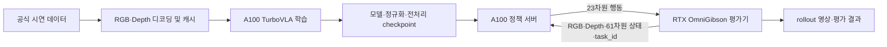

# TurboVLA 기반 BEHAVIOR 2026 학습 기반 구축 보고서

작성일: 2026년 10월 4일, 한국 시간 기준  
대상 프로젝트: NEW_TECHNYONG_TURBO_VLA  
작업 범위: 기본 R1Pro 로봇을 사용하는 RGB/RGB-D 모방학습 및 평가 연동 기반  
현재 단계: 코드 구현 및 CPU 계약·통합 검증 완료, 실제 서버·공식 데이터·시뮬레이터 검증 대기

## 1. 핵심 결과

오늘 작업에서는 TurboVLA를 BEHAVIOR 2026의 데이터 및 기본 R1Pro 인터페이스에 맞춰 학습할 수 있도록 전용 경로를 정비했다. 초기 RGB 구성에서 시작해 depth 디코딩, RGB-D 캐시, 4채널 모델 입력, 학습 가능한 depth 커널, 체크포인트 재로딩, websocket 평가 서버까지 연결했다.

CPU 계약·통합 테스트 24개를 모두 통과했으며 생략된 테스트는 없다. 합성 12비트 depth 영상의 실제 인코딩·디코딩과 소형 로컬 DINOv3/BERT를 사용하는 forward/backward, depth gradient, 체크포인트 재로딩을 확인했다. 실제 학습 명령 진입점에서도 합성 데이터와 소형 backbone으로 한 optimizer step 및 검증·저장까지 실행했다.

공식 시연 에피소드를 이용한 학습, A100 CUDA/BF16 실행, OmniGibson에서의 로봇 제어는 아직 실행하지 않았다. 따라서 현재 결과는 **대회 학습을 시작하기 위한 코드 기반과 CPU 검증의 완료**이며, 학습 성능이나 대회 task 성공률의 확보를 의미하지 않는다.

### 성과 요약

| 항목 | 오늘 확보한 결과 | 남은 확인 |
| --- | --- | --- |
| 관측·행동 인터페이스 | 기본 R1Pro의 상태 61차원, 행동 23차원, 세 카메라 매핑 | 실제 evaluator 관측으로 확인 |
| 공식 데이터 형식 | LeRobot v3 메타데이터·task parquet·episode offset 대응 | 실제 배포된 episode 처리 |
| RGB-D 경로 | 다운로드 선택 → depth 디코딩 → 캐시 → 학습 → 정책 입력 구현 | 공식 영상 및 서버 실행 |
| 모델 학습 가능성 | 소형 CPU 모델에서 depth gradient와 optimizer 업데이트 확인 | 실제 DINOv3 ViT-B와 A100 BF16 |
| 학습 실행 | 실제 train CLI의 synthetic 1-step, 검증 및 checkpoint 저장 | 공식 데이터로 동일 절차 |
| 평가 통신 | 실제 로컬 websocket 왕복 및 reset 프로토콜 확인 | OmniGibson과 연결한 rollout |
| 패키지 관리 | 실행 안내서·검증 기록·SHA256 갱신 | A100 환경에서 설치 결과 기록 |

## 2. 작업 배경과 목적

사용 목적은 BEHAVIOR 2026 참가를 위해 TurboVLA를 A100 서버에서 학습하는 것이다. 이때 모델의 실행 가능성만으로는 충분하지 않다. 데이터에 들어 있는 이미지, 상태, 행동의 의미가 학습기와 평가 환경에서 동일하게 해석되어야 한다.

TurboVLA 저장소에는 LIBERO와 RoboTwin 관련 구성 및 BEHAVIOR용 초기 어댑터가 있었지만, 공식 task 메타데이터 형식, RGB-D 전체 학습 경로, 메모리 사용, 서버 간 모델 경로, 평가기의 통신 규약을 추가로 맞춰야 했다.

오늘 작업의 구체적인 목적은 다음과 같다.

1. 공식 시연 데이터와 기본 R1Pro 로봇의 입력·출력 규격을 맞춘다.
2. RGB뿐 아니라 depth가 실제 학습에 사용되는 RGB-D 경로를 구현한다.
3. 대용량 RGB를 한꺼번에 RAM에 적재하는 구조를 줄인다.
4. A100 학습 환경과 RTX 시뮬레이터 환경을 분리해 연결한다.
5. 실행 가능한 설치·학습 절차와 회귀 테스트를 제공한다.
6. 완료한 검증과 서버에서 추가로 해야 할 검증을 구분한다.

초기에는 로컬 PC의 학습 환경을 준비하는 방향으로 접근했으나, 실제 학습은 A100 서버에서 진행한다는 요구에 맞춰 서버용 코드와 인터페이스 정비로 범위를 조정했다. 이후 로컬 설치는 CPU 회귀 검증에 필요한 패키지를 격리하는 용도로만 사용했다.

## 3. 학습·평가 시스템 구성

### 3.1 환경 분리의 이유

A100은 학습용 계산 GPU로 사용하지만, Isaac Sim 공식 요구사항에서는 RT 코어가 없는 A100을 지원 GPU로 분류하지 않는다. 화면을 띄우지 않는 headless 실행도 RGB 관측 생성에 렌더링을 사용하므로 지원 조건을 없애지 않는다. 이에 따라 학습·정책 추론과 시뮬레이터 평가를 별도 환경으로 구성했다. [Isaac Sim 요구사항](https://docs.isaacsim.omniverse.nvidia.com/5.1.0/installation/requirements.html)

| 환경 | 주요 역할 | 실행 상태 |
| --- | --- | --- |
| 로컬 CPU 테스트 환경 | 데이터 규약, 합성 영상, 소형 모델, 통신 회귀 검증 | 오늘 실행 완료 |
| A100 서버의 전용 Python 환경 | 데이터 준비, GPU 학습, checkpoint 생성, 정책 서버 | 서버 확보 후 실행 |
| 지원되는 RTX GPU의 BEHAVIOR 환경 | OmniGibson/Isaac Sim 실행, 관측 생성, 행동 적용, rollout 기록 | 별도 준비·검증 필요 |

학습 환경과 시뮬레이터 환경을 분리하면 각각의 PyTorch, NumPy, Isaac Sim 의존성을 동일 환경에 강제로 설치할 필요가 줄어든다. 두 환경은 websocket으로 관측과 행동을 교환한다. 이 구성의 실제 지연과 제어 안정성은 아직 측정하지 않았다.

### 3.2 시스템 구성도



이 그림은 구현한 목표 구성을 나타낸다. A100 서버와 실제 시뮬레이터 사이의 전체 연결을 오늘 실행했다는 의미는 아니다.

### 3.3 평가 버전 관리

오늘 확인한 공식 baseline 안내는 BEHAVIOR-1K `v3.9.3`를 평가 환경 기준으로 안내했다. 첨부 checkout의 일부 문서는 `v3.9.2`를 표기하므로, 실제 평가 환경은 공식 안내에 맞춰 별도로 준비하고 tag 및 commit을 기록해야 한다. 오늘 포함된 BEHAVIOR 소스를 `v3.9.3`로 교체하거나 그 버전의 시뮬레이터를 실행하지는 않았다. [공식 baseline 안내](https://behavior.stanford.edu/challenge/baselines.html)

## 4. 입력·출력 규격 정합성

### 4.1 이미지 입력

| 항목 | RGB 경로 | RGB-D 경로 |
| --- | --- | --- |
| 카메라 수 | 3 | 3 |
| 카메라 순서 | head → left wrist → right wrist | 동일 |
| 입력 RGB 형식 | HWC uint8 RGB 또는 RGBA | 동일 |
| Alpha 처리 | 제거 | 제거; depth로 사용하지 않음 |
| 기본 모델 해상도 | 224 × 224 | 224 × 224 |
| RGB 채널 전처리 | 0~1 변환 후 DINOv3 processor mean/std | 동일 |
| Depth 채널 전처리 | 사용하지 않음 | m 변환, 0.01~10 m clip, nearest resize, 10으로 나눔 |
| 모델 tensor | `[B, 3, 3, 224, 224]` | `[B, 3, 4, 224, 224]` |

`B`는 batch 크기다. 카메라 축과 채널 축을 구분하며, RGB-D의 네 번째 채널은 별도의 depth 이미지다. 학습기와 정책 추론기는 같은 전처리 함수를 사용한다.

기본 full-resolution 평가 wrapper의 head 관측은 720 × 720, wrist 관측은 각각 480 × 480이다. 모델 입력 단계에서는 이를 기본 224 × 224로 리사이즈한다. 원본 관측 해상도와 모델 입력 해상도를 구분해야 한다.

### 4.2 61차원 상태 입력

기본 R1Pro 설정의 `proprio_obs` 순서를 따른다. 상태의 앞부분을 임의로 자르거나 다른 benchmark 상태 벡터로 대체하지 않는다.

| 구성 요소 | 인덱스 범위, 끝 인덱스 제외 | 차원 |
| --- | --- | --- |
| Base local-frame velocity | `[0:3]` | 3 |
| 왼팔 joint position | `[3:10]` | 7 |
| 왼팔 joint velocity | `[10:17]` | 7 |
| 왼쪽 end-effector position | `[17:20]` | 3 |
| 왼쪽 end-effector quaternion | `[20:24]` | 4 |
| 왼쪽 gripper joint position | `[24:26]` | 2 |
| 왼쪽 gripper joint velocity | `[26:28]` | 2 |
| 오른팔 joint position | `[28:35]` | 7 |
| 오른팔 joint velocity | `[35:42]` | 7 |
| 오른쪽 end-effector position | `[42:45]` | 3 |
| 오른쪽 end-effector quaternion | `[45:49]` | 4 |
| 오른쪽 gripper joint position | `[49:51]` | 2 |
| 오른쪽 gripper joint velocity | `[51:53]` | 2 |
| Trunk joint position | `[53:57]` | 4 |
| Trunk joint velocity | `[57:61]` | 4 |
| **합계** | `[0:61]` | **61** |

관측 서버는 기본적으로 `robot_r1::proprio`를 사용한다. 상태의 길이가 다르거나 NaN 등 유효하지 않은 값이 포함되면 오류로 처리한다.

### 4.3 23차원 행동 출력

| 구성 요소 | 인덱스 범위, 끝 인덱스 제외 | 차원 | 제어 입력 의미 |
| --- | --- | --- | --- |
| Base | `[0:3]` | 3 | 로봇 local frame의 속도 제어 입력 |
| Trunk | `[3:7]` | 4 | 절대 joint position 명령 |
| Left arm | `[7:14]` | 7 | 절대 joint position 명령 |
| Left gripper | `[14:15]` | 1 | 연속 gripper 제어 입력 |
| Right arm | `[15:22]` | 7 | 절대 joint position 명령 |
| Right gripper | `[22:23]` | 1 | 연속 gripper 제어 입력 |
| **합계** | `[0:23]` | **23** | 원본 시연·controller 입력 순서 유지 |

관측의 gripper position은 각 손 2차원이지만 행동의 gripper 명령은 각 손 1차원이다. 상태 벡터와 행동 벡터는 서로 다른 규격이며, 이 차원을 혼동하지 않는다.

Base 명령에 wheel radius나 추가 속도 계수를 다시 곱하지 않고, gripper를 임의로 이진화하지 않는다. 모델의 정규화된 출력은 checkpoint의 action 통계로 복원한 뒤 공식 controller 입력으로 전달한다. 이 규약은 기본 `r1pro.yaml`을 전제로 하며 custom robot/controller에는 별도 매핑이 필요하다.

### 4.4 시간과 action chunk

시연 데이터는 30 Hz를 전제로 검증한다. 기본 horizon은 12이며 출력은 `[B, 12, 23]`이다. 정책 서버의 초기 설정은 `execute_steps=1`이므로 예측한 chunk 전체를 한 번에 실행하지 않고 한 제어 step부터 검증한다. Chunk의 길이와 실제 open-loop 실행 길이는 별개다.

## 5. 데이터 처리 경로 개선

### 5.1 공식 task 메타데이터 지원

초기 어댑터의 JSONL 기반 task 처리를 공식 데이터의 `meta/tasks.parquet`에 대응하도록 수정했다. Parquet의 task 문자열이 일반 컬럼 또는 pandas index 컬럼으로 저장된 경우를 처리하며, 기존 JSONL 형식은 fallback으로 유지한다.

평가 시 전달되는 `task_id`는 dataset의 task instruction에 매핑한다. 알 수 없는 task를 임의의 기본 instruction으로 대체하지 않는다.

### 5.2 선택 다운로드와 revision 기록

Downloader는 명시한 task chunk와 episode에 필요한 영상 shard를 선택한다. RGB-D를 선택하면 세 RGB 영상 외에 세 depth 영상의 shard도 받는다. 특정 task chunk의 data parquet는 chunk 단위로 내려받으며, 영상 shard 하나에 여러 episode가 들어 있을 수 있으므로 선택 episode 수만으로 다운로드 크기를 단정할 수 없다.

Hugging Face revision을 commit SHA로 확인하고 `turbovla_source.json`에 저장한다. 이미 revision이 기록된 root에는 다른 revision을 섞지 않도록 거절한다. 데이터 root의 의미와 코드 저장소의 의미도 구분한다. BEHAVIOR 소스가 포함되어 있어도 시연 영상이나 시뮬레이터 에셋이 자동으로 포함되는 것은 아니다.

### 5.3 Episode 및 영상 시간 정렬

데이터 변환은 episode별 frame index와 timestamp를 검사한다. Frame이 누락되거나 순서가 연속적이지 않으면 완료된 episode로 인정하지 않는다. RGB와 depth는 각각 metadata의 `from_timestamp`를 더해 해당 영상의 올바른 구간을 디코딩한다.

영상에서 요청 시각에 대응하는 frame을 찾지 못하거나 끝까지 읽지 못하면 오류로 처리한다. RGB-D에서는 메타데이터상의 원래 RGB/depth 해상도를 확인하고 depth 영상의 실제 해상도도 검사한다.

### 5.4 메모리 매핑 캐시

초기 NPZ 방식은 RGB를 읽어 전체 episode 이미지를 RAM에 적재했다. 기본 cache를 NPY 메모리 매핑 방식으로 바꿔 영상 frame 단위로 디스크에 기록하고 필요한 frame에 접근하도록 했다.

```text
episode_000000/
├── rgb.npy          [T, 3, H, W, 3], uint8
├── depth.npy        [T, 3, H, W], float32 metres; RGB-D에서만 생성
├── states.npy       [T, 61], float32
├── actions.npy      [T, 23], float32
└── metadata.json    카메라·modality·episode·source 정보와 완료 표시
```

`metadata.json`은 변환 완료 후 기록한다. 변환이 중단돼 완료 표시가 없는 cache는 유효한 episode로 로딩되지 않는다. 소량 데이터용 NPZ 경로도 유지했다.

메모리 매핑이 전체 데이터 규모의 RAM·I/O 문제를 모두 해결했다는 의미는 아니다. 캐시 저장공간, 운영체제 page cache, shuffle 및 파일 수 비용은 별도로 관리해야 한다.

### 5.5 캐시 용량의 계산 예시

기본 224 × 224, 카메라 3개 기준 순수 영상 array 크기는 다음과 같다.

| 구성 | 계산 | frame당 크기 |
| --- | --- | --- |
| RGB uint8 | `3 × 224 × 224 × 3 × 1 byte` | 451,584 bytes |
| Depth float32 | `3 × 224 × 224 × 4 bytes` | 602,112 bytes |
| RGB-D 합계 | 두 영상 array의 합 | 1,053,696 bytes, 약 1.005 MiB |

30 Hz 영상 1분, 1,800 frames의 RGB-D 캐시는 영상 array만 약 1.90 GB, 약 1.77 GiB다. 상태·행동·파일 header와 기타 비용은 별도다. 이 값은 코드의 dtype·shape에서 계산한 용량이며 실제 전체 dataset 크기를 측정한 결과는 아니다. 따라서 시작 단계에서는 소수 episode와 한 task부터 준비한다.

## 6. RGB-D 구현의 핵심

### 6.1 Depth 단위와 인코딩 구분

공식 depth 영상 메타데이터의 원본 형식은 `gray12le`, 12비트 로그 인코딩이다. 반면 `video.output_unit=mm`는 공식 loader의 출력 단위를 표시한다. 원본 픽셀 값을 곧바로 mm나 m로 간주하면 거리가 잘못 복원된다. [공식 depth 메타데이터](https://huggingface.co/datasets/behavior-1k/2026-challenge-demos/blob/main/meta/info.json)

새 decoder는 native gray/Y plane의 12비트 코드를 직접 읽고, FFmpeg row padding을 제외한다. RGB로 변환하거나 다른 bit depth로 재변환해 원본 코드를 바꾸지 않는다. 허용하지 않는 pixel format이나 로그 인코딩 조건은 거절한다.

복원에는 공식 코드와 같은 depth minimum 0.01 m, maximum 10 m, shift 3.5를 사용한다. 복원한 m 값을 cache에 기록하고 RGB-D 전처리에서 10으로 나눈다. 공식 loader의 mm 출력을 다시 사용하는 경로와 혼합하지 않으므로 단위 변환을 중복하지 않는다.

### 6.2 학습과 실시간 입력의 일치

학습 cache는 m 단위다. 실시간 OmniGibson의 `depth_linear`는 metric sensor 입력으로 처리한다. RGB와 depth는 별도로 받아 공간 정렬을 확인하며 RGBA alpha를 depth로 해석하지 않는다.

실시간 sensor의 positive infinity는 공식 시연 quantizer가 최대 깊이로 포화시키는 것과 맞춰 10 m로 처리한다. NaN, negative infinity, 음수 및 누락된 depth는 유효한 depth로 간주하지 않는다.

### 6.3 Depth를 실제로 학습하도록 수정

RGB 사전학습 모델에 네 번째 채널을 추가할 때 새 depth 가중치를 0으로 초기화하면 처음에는 기존 RGB 함수가 유지된다. 그러나 그 상태에서 전체 backbone을 freeze하면 새 depth 가중치도 업데이트되지 않아 모델이 depth를 계속 무시한다.

이를 방지하기 위해 기존 RGB kernel과 분리된 `depth_weight`를 추가했다. Frozen recipe에서는 새 depth kernel만 학습 가능하게 유지하고, 기존 RGB kernel·bias와 나머지 DINOv3 가중치는 고정한다.

| 모델 부분 | RGB 구성 | RGB-D 구성 |
| --- | --- | --- |
| DINOv3 RGB 가중치 | Frozen | Frozen |
| 새 depth kernel | 없음 | **Trainable**, 0 초기화 |
| BERT 가중치 | Frozen | Frozen |
| Projection·fusion·action 모듈 | Trainable | Trainable |

소형 모델 검증에서 초기 RGB-only 응답과 RGB-D의 초기 응답이 일치했고, backward 후 depth gradient가 0이 아니며 optimizer step 후 depth 가중치가 변경되는 것을 확인했다. 같은 step에서 기존 RGB 가중치는 변경되지 않았다.

Depth kernel까지 gradient를 전달하려면 DINOv3의 연산 graph를 유지해야 하므로, 가중치를 대부분 고정하더라도 RGB 구성보다 학습 메모리가 늘어날 수 있다. 실제 증가량은 A100에서 측정해야 한다.

## 7. 학습기 구성 및 안정성 처리

현재 학습기는 단일 GPU RGB/RGB-D 모방학습 경로다. Multi-process DDP는 구현하지 않았으며 여러 프로세스로 실행하려고 하면 명시적으로 거절한다.

| 항목 | 기본 또는 시작 설정 |
| --- | --- |
| 실제 시연 주기 | 30 Hz |
| Image size | 224 |
| Action/state dimension | 23 / 61 |
| Horizon | 12 |
| Optimizer | AdamW |
| Learning rate | 기본 `1e-4` |
| 손실 | 유효 action frame만 포함하는 정규화된 L1 |
| Gradient clipping | 최대 norm 1.0 |
| A100 vision 연산 | BF16 autocast |
| Fusion/action 연산 | FP32 |
| 작은 학습 시작 예시 | batch 2, accumulation 4, 유효 batch 8 |
| 처음 smoke test | batch 1, accumulation 1, optimizer step 1 |

위 batch와 step 수는 실행을 시작하기 위한 예시다. A100 메모리·처리량을 측정해 도출한 최적값이 아니다.

정규화 통계는 training episode에서만 계산한다. 상태에는 평균·표준편차 정규화를, 행동에는 training minimum/maximum 기반 정규화를 적용한다. 일정한 행동 차원은 안정적으로 처리하며 추론 시 training 통계로 복원한다.

Train/validation에 같은 episode ID가 겹치거나 중복된 경우를 거절한다. Episode 마지막의 부족한 chunk는 padding하지만 해당 frame을 loss에서 제외한다. 검증 loss는 23개 행동 차원별로 출력해 전체 평균만으로 일부 제어 차원의 문제를 가리지 않도록 했다.

Checkpoint에는 모델 가중치, optimizer, step, 모델 구성, 정규화, 이미지 전처리, split ID 및 RGB/RGB-D 정보 등을 저장한다. 임시 checkpoint 파일을 작성한 뒤 최종 파일로 바꿔 중간 저장 파일을 완료된 checkpoint로 취급하지 않도록 했다.

재개 시 모델·optimizer를 복원하고 split, 정규화, 주요 구성 및 저장된 데이터 provenance의 불일치를 검사한다. RNG와 sampling 순서를 완전히 복원하는 bitwise 재현 재개는 아니다.

이 경로는 DINOv3/BERT 사전학습 가중치를 사용하는 구성이며, fusion/action은 기본적으로 새로 학습한다. `INITIAL_WEIGHTS`는 key와 tensor shape가 맞는 core 가중치만 이식한다. 기존 다른 benchmark의 행동 head가 BEHAVIOR용으로 변환 완료된 것으로 간주하지 않는다.

## 8. 평가 서버 연결

### 8.1 관측 매핑

서버는 기본 R1Pro의 세 RGB key, 61차원 proprioception, task ID를 명시적으로 매핑한다. RGB-D checkpoint면 세 `depth_linear` 관측도 요구한다. Camera-relative pose 같은 추가 evaluator 필드는 모델 입력에 전달하지 않는다.

로봇·카메라 이름을 바꾸면 `--rgb-keys`, `--state-key`를 지정해야 한다. RGB-D에서는 `--depth-keys`도 함께 지정해야 한다. Controller나 proprioception 순서가 변경되면 key 변경만으로 충분하지 않고 별도 mapping이 필요하다.

### 8.2 통신과 episode 상태

서버는 공식 평가기의 msgpack array 형식과 맞춰 관측을 수신하고 `action[23]`을 반환한다. 연결 시 metadata를 보내고 `/healthz` endpoint를 제공한다.

공식 reset 요청은 client가 응답을 기다리지 않는 구조다. 이에 따라 reset ACK를 보내지 않고 내부 action queue만 비운다. ACK를 보냈을 때 다음 action 수신과 메시지 순서가 어긋나는 문제를 피한다.

현재 하나의 정책 서버는 하나의 rollout 연결을 처리한다. 동시 연결의 action queue가 섞이지 않도록 추가 rollout을 거절한다. Episode reset, 연결 종료 및 새 연결 시 queue를 초기화한다.

### 8.3 Checkpoint의 서버 이동

학습 서버와 추론 서버에서 모델 파일의 절대 경로가 다를 수 있으므로 checkpoint 로딩 시 DINOv3/BERT 경로를 덮어쓸 수 있도록 했다. 경로만 바꾸되 모델 가중치는 checkpoint에서 엄격하게 로딩한다.

RGB-D checkpoint는 modality와 depth 입력이 일치해야 한다. Depth가 없는데 RGB-D 모델을 실행하거나 RGB 모델에 depth를 잘못 추가하는 경우를 거절한다.

## 9. 문제와 수정 내용 비교

| 확인한 문제 또는 보완점 | 수정 내용 | 확인한 근거 |
| --- | --- | --- |
| 공식 task parquet에 대응하지 못하는 초기 loader | Parquet 및 pandas index 컬럼 지원, JSONL fallback | Task metadata 테스트 |
| 큰 RGB episode를 RAM에 전부 적재 | 기본 NPY mmap cache, frame 단위 기록·접근 | Mmap cache 및 통계 테스트 |
| Depth decoder와 학습 경로 부재 | Native 12비트 decoder와 RGB-D cache/학습 연결 | 합성 HEVC→cache→batch 통합 테스트 |
| Raw log12와 loader의 mm 단위 혼동 가능성 | Raw 코드에서 m로 복원, cache 단위 명시 | Metadata·단위·영상 decoder 테스트 |
| Zero depth kernel까지 freeze되어 depth 무시 | 분리된 trainable depth kernel | Nonzero gradient·가중치 변경 테스트 |
| 다른 서버에서 원래 모델 경로가 없을 수 있음 | 모델 경로 override | Checkpoint policy reload 테스트 |
| 실제 평가 관측 key와 초기 adapter 사이의 간격 | 기본 R1Pro key whitelist 매핑 | 카메라·상태 순서 테스트 |
| Reset 응답이 action stream에 섞일 가능성 | Reset ACK 미전송, queue 초기화 | 실제 websocket loopback 테스트 |
| RGB와 RGB-D cache/input 혼용 가능성 | Modality·shape·unit 검사 | Cache 및 server 입력 테스트 |
| DDP가 없는 학습기를 다중 실행할 가능성 | WORLD_SIZE 검사와 명시적 거절 | 코드에서 실행 제한 구현; 다중 GPU 실행은 미검증 |

표의 수정 내용은 코드 구현 또는 CPU 근거를 나타낸다. 실제 대회 환경에서 모든 오류가 제거되었음을 보장하지 않는다.

## 10. 검증 결과와 범위

### 10.1 테스트 구성

| 테스트 파일 | 테스트 수 | 주요 범위 | 결과 |
| --- | --- | --- | --- |
| `test_behavior_contract.py` | 10 | Shape, 단위, alpha, 정규화, padding, 기본 구성 격리 | 모두 통과 |
| `test_behavior_server_contract.py` | 8 | Mmap, task metadata, 관측 순서, RGB 영상, 실제 websocket 왕복 | 모두 통과 |
| `test_behavior_rgbd.py` | 5 | Native 12비트 plane, depth units, live 입력, HEVC→RGB-D cache | 모두 통과 |
| `test_behavior_rgbd_model.py` | 1 | 소형 모델 gradient, RGB 보존, checkpoint reload, 실제 train CLI 1-step | 통과 |
| **합계** | **24** | CPU 계약 및 통합 검증 | **24 통과, 0 실패, 0 skip** |

소형 모델 테스트 하나는 여러 검증 단계를 포함한다. 테스트 개수를 benchmark task 수나 rollout 횟수로 해석하면 안 된다.

Python 문법 검사, TOML metadata 검사, A100용 Bash 스크립트 문법 검사 및 prepare/train CLI help도 확인했다. 패키지 코드 정리 단계에서 기존 소스 4,194개 파일의 SHA256을 갱신하고 변경된 소스 29개 파일의 hash 일치를 별도 확인했다. 이 수는 그 시점의 패키지 파일 수이며 보고서 파일을 추가한 뒤에는 manifest의 항목 수가 증가할 수 있다.

### 10.2 실제 CPU 환경과 목표 A100 환경의 차이

| 항목 | 오늘 실행한 CPU 테스트 환경 | 작성한 A100 환경 |
| --- | --- | --- |
| OS | Windows | Linux 대상 |
| Python | 3.14.7 | 3.11 |
| PyTorch | 2.14.1+cpu | 2.7.1, CUDA 12.6 wheel |
| Torchvision | 0.29.1+cpu | 0.22.1 |
| Transformers | 4.56.2 | 4.56.2 |
| NumPy | 2.5.3 | 1.26.4 |
| PyAV | 19.0.1 | 14.4.0 |
| PyArrow | 25.0.1 | 19.0.1 |
| Pillow | 12.3.0 | 11.3.0 |
| GPU/CUDA/BF16 검증 | 수행하지 않음 | 서버에서 수행 예정 |

로컬 CPU 환경은 테스트 패키지를 `.test-deps`에 격리한 것이다. 이 폴더의 Windows CPU wheel을 Linux A100 서버의 환경으로 복사해 사용하지 않는다. A100 서버에서는 전용 설치 스크립트로 환경을 새로 만든다.

### 10.3 아직 검증하지 않은 항목

| 미검증 항목 | 현재 확인할 수 없는 이유 또는 남은 실행 |
| --- | --- |
| 공식 실제 episode 디코딩 | 오늘 통합 테스트는 합성 영상 및 synthetic metadata 사용 |
| A100 고정 환경 설치 | 실제 서버와 driver 정보 미확보 |
| A100 BF16 forward/backward | 오늘 모델 검증은 CPU FP32 |
| 실제 DINOv3 ViT-B 규모의 메모리·처리량 | 모델 테스트는 소형 backbone 사용 |
| 공식 데이터 학습의 loss 추세 | 실제 시연으로 장시간 학습 미실행 |
| OmniGibson closed-loop rollout | 실제 simulator/RTX 환경 미실행 |
| Task 성공률·평가 점수 | 실제 rollout 및 benchmark 평가 미실행 |
| 전체 데이터 규모의 성능 | 저장공간, shuffle, 처리량 검증 미실행 |
| Multi-GPU 학습 | DDP 구현 범위에 포함하지 않음 |

“24개 테스트 통과”는 위 항목까지 통과했다는 뜻이 아니다. CPU 검증과 실제 대회 환경 검증은 별도의 단계다.

## 11. 생성·수정한 주요 산출물

| 파일 또는 모듈 | 역할 |
| --- | --- |
| `tasks.py` | Task parquet·JSONL instruction 로딩 |
| `download.py` | Task/episode 선택 영상 다운로드와 HF revision 기록 |
| `preflight.py` | CUDA/BF16·모델 설정·schema·영상 존재 사전 검사 |
| `depth.py` | Native 12비트 depth 영상 디코딩 |
| `prepare.py` | RGB/RGB-D episode 변환 및 cache 생성 |
| `data.py` | Mmap/NPZ 로딩, 정규화 통계, 학습 sample 생성 |
| `preprocessing.py` | 학습·추론 공통 RGB/depth 전처리 및 정규화 |
| `train.py` | 단일 GPU 학습·검증·저장·재개 |
| `observations.py` | 공식 R1Pro 관측 key 및 행동 순서 |
| `policy.py`, `serve.py` | Checkpoint 정책, 관측 처리, websocket server |
| `turbovla/models/vision_encoder.py` | 4채널 확장 및 trainable depth kernel |
| `setup_a100.sh`, `requirements-a100.txt` | 목표 서버 환경 설치와 의존성 고정 |
| `train_a100.sh` | 학습 경로·split·batch·RGB-D 실행 구성 |
| `tests/test_behavior*.py` | 24개 계약·통합 테스트 |
| `A100_SETUP_KO.md`, `VALIDATION_KO.md` | 실행 절차 및 검증 범위 |
| `APPLIED_BEHAVIOR_FIXES_KO.md` | 전체 적용 내역 |
| `update_manifest.py`, `PACKAGE_SHA256.json` | 패키지 파일 hash 관리 |

## 12. A100 서버 확보 후 진행할 작업

### 12.1 서버 확보 전 가능한 준비

코드 정리, 모델 가중치와 시연 데이터 다운로드, CPU 영상 디코딩·cache 생성, CPU 회귀 테스트는 A100 없이 가능하다. 다만 시연과 cache 용량이 커질 수 있으므로 저장공간과 서버로의 전송 시간을 고려해야 한다. 상황에 따라 데이터 다운로드·cache 생성은 서버에서 직접 수행하는 편이 효율적일 수 있다.

현재 `preflight.py`는 CUDA/BF16 검사를 포함하므로 CPU-only 사전 준비 단계에서는 통과 대상이 아니다. 서버용 `setup_a100.sh` 역시 GPU 검사까지 포함한다.

### 12.2 서버 준비 시 확인할 정보

서버 OS, Python 3.11 설치 가능 여부, A100 개수·VRAM, NVIDIA driver, 데이터 저장 경로·남은 공간, 인터넷 및 Hugging Face 접근, 추후 RTX 평가기와의 네트워크 연결을 확인한다. 아직 이 정보는 확보되지 않았다.

### 12.3 실행 단계와 통과 기준

| 단계 | 실행 내용 | 다음 단계로 넘어갈 기준 |
| --- | --- | --- |
| 1 | 코드 전송·서버 사양 확인 | 경로 확인, GPU 인식, 저장공간 확보 |
| 2 | A100 전용 환경 설치 | pip check, CUDA/BF16 검사, CPU 테스트 성공 |
| 3 | DINOv3/BERT와 소수 episode 준비 | 접근 가능한 weights, HF SHA 기록, metadata 존재 |
| 4 | RGB-D preflight와 cache 생성 | Schema·depth encoding·영상·timestamp 검사 통과 |
| 5 | 실제 A100 1-step 학습 | Finite train/validation loss, `step_1.pt` 생성 |
| 6 | Checkpoint 정책 로딩 | 모델 로딩 성공, 정상 action shape, server 시작 |
| 7 | 작은 학습 실험 | Loss 추세, VRAM, step 속도 및 validation 관찰 |
| 8 | RTX에서 closed-loop 평가 | 관측·행동 순서, 제어 단위, reset 확인, rollout 기록 |
| 9 | 데이터·batch 확대 | 작은 실험 및 평가에서 발견한 문제 해결 후 확장 |

### 12.4 첫 실행 예시

아래 명령은 안내서에 따라 모델 경로, cache, train/validation episode ID를 먼저 설정한 뒤 사용한다.

```bash
bash scripts/behavior_2026/setup_a100.sh
source .venv-behavior/bin/activate

export RUN_DIR=outputs/behavior-rgbd-smoke
RGBD=1 STEPS=1 BATCH_SIZE=1 GRAD_ACCUMULATION=1 \
  bash scripts/behavior_2026/train_a100.sh
```

전체 다운로드·전처리·서버·평가 명령은 [A100 실행 안내서](../A100_SETUP_KO.md)에 정리되어 있다. 처음부터 full dataset이나 장시간 학습을 실행하지 않고 작은 실제 데이터 실험으로 환경 결합을 확인한다.

## 13. 발표에서 사용할 수 있는 성과 문장

> TurboVLA를 기본 R1Pro의 61차원 상태·23차원 행동·3개 카메라 규격에 맞추고, RGB-D 다운로드부터 depth 디코딩·캐시·학습·체크포인트·평가 서버까지 전용 경로를 구현했다. CPU 계약·통합 테스트 24개와 실제 학습 진입점의 합성 데이터 1-step을 통과했다. 실제 A100 학습과 OmniGibson 평가는 다음 검증 단계다.

발표에서는 “BEHAVIOR 대회 학습 완료”, “A100 학습 성공”, “실제 로봇 task 성공”, “실환경 완전 호환”을 현재 성과로 표기하지 않는다. 그런 결과를 얻기 위한 기반을 구현하고 CPU에서 검증한 단계로 설명한다.

## 14. 근거 자료

프로젝트 내부 근거:

- [적용 내역](../../../APPLIED_BEHAVIOR_FIXES_KO.md)
- [검증 기록](../VALIDATION_KO.md)
- [A100 실행 안내서](../A100_SETUP_KO.md)
- [BEHAVIOR 어댑터 설명](../README.md)
- [PPT 구성안](2026-10-04_PPT_구성안.md)

공식 외부 근거:

- [BEHAVIOR 2026 baseline 및 환경 안내](https://behavior.stanford.edu/challenge/baselines.html)
- [BEHAVIOR 2026 평가 안내](https://behavior.stanford.edu/challenge/evaluation.html)
- [공식 시연 데이터 info.json](https://huggingface.co/datasets/behavior-1k/2026-challenge-demos/blob/main/meta/info.json)
- [Isaac Sim 5.1 GPU 요구사항](https://docs.isaacsim.omniverse.nvidia.com/5.1.0/installation/requirements.html)

외부 페이지의 내용은 변경될 수 있다. 위 버전과 형식은 오늘 작업 당시 확인한 안내를 기준으로 하며 실제 실행 시 사용한 dataset revision 및 evaluator commit을 별도로 남긴다.
