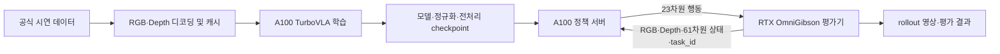

# TurboVLA 기반 BEHAVIOR 2026 학습 기반 구축 보고서

작성일: 2026년 10월 4일, 한국 시간 기준  
대상 프로젝트: NEW_TECHNYONG_TURBO_VLA  
작업 범위: 기본 R1Pro 로봇을 사용하는 RGB/RGB-D 모방학습 및 평가 연동 기반  
현재 단계: 코드 구현 및 CPU 계약·통합 검증 완료, 실제 서버·공식 데이터·시뮬레이터 검증 대기

## 1. 핵심 결과

오늘 작업에서는 TurboVLA를 BEHAVIOR 2026의 데이터 및 기본 R1Pro 인터페이스에 맞춰 학습할 수 있도록 전용 경로를 정비했다. 초기 RGB 구성에서 시작해 depth 디코딩, RGB-D 캐시, 4채널 모델 입력, 학습 가능한 depth 커널, 체크포인트 재로딩, websocket 평가 서버까지 연결했다.

CPU 계약·통합 테스트 24개를 모두 통과했으며 생략된 테스트는 없다. 합성 12비트 depth 영상의 실제 인코딩·디코딩과 소형 로컬 DINOv3/BERT를 사용하는 forward/backward, depth gradient, 체크포인트 재로딩을 확인했다. 실제 학습 명령 진입점에서도 합성 데이터와 소형 backbone으로 한 optimizer step 및 검증·저장까지 실행했다.

공식 시연 에피소드를 이용한 학습, A100 CUDA/BF16 실행, OmniGibson에서의 로봇 제어는 아직 실행하지 않았다. 따라서 현재 결과는 **대회 학습을 시작하기 위한 코드 기반과 CPU 검증의 완료**이며, 학습 성능이나 대회 task 성공률의 확보를 의미하지 않는다.

### 성과 요약

| 항목 | 오늘 확보한 결과 | 남은 확인 |
| --- | --- | --- |
| 관측·행동 인터페이스 | 기본 R1Pro의 상태 61차원, 행동 23차원, 세 카메라 매핑 | 실제 evaluator 관측으로 확인 |
| 공식 데이터 형식 | LeRobot v3 메타데이터·task parquet·episode offset 대응 | 실제 배포된 episode 처리 |
| RGB-D 경로 | 다운로드 선택 → depth 디코딩 → 캐시 → 학습 → 정책 입력 구현 | 공식 영상 및 서버 실행 |
| 모델 학습 가능성 | 소형 CPU 모델에서 depth gradient와 optimizer 업데이트 확인 | 실제 DINOv3 ViT-B와 A100 BF16 |
| 학습 실행 | 실제 train CLI의 synthetic 1-step, 검증 및 checkpoint 저장 | 공식 데이터로 동일 절차 |
| 평가 통신 | 실제 로컬 websocket 왕복 및 reset 프로토콜 확인 | OmniGibson과 연결한 rollout |
| 패키지 관리 | 실행 안내서·검증 기록·SHA256 갱신 | A100 환경에서 설치 결과 기록 |

## 2. 작업 배경과 목적

사용 목적은 BEHAVIOR 2026 참가를 위해 TurboVLA를 A100 서버에서 학습하는 것이다. 이때 모델의 실행 가능성만으로는 충분하지 않다. 데이터에 들어 있는 이미지, 상태, 행동의 의미가 학습기와 평가 환경에서 동일하게 해석되어야 한다.

TurboVLA 저장소에는 LIBERO와 RoboTwin 관련 구성 및 BEHAVIOR용 초기 어댑터가 있었지만, 공식 task 메타데이터 형식, RGB-D 전체 학습 경로, 메모리 사용, 서버 간 모델 경로, 평가기의 통신 규약을 추가로 맞춰야 했다.

오늘 작업의 구체적인 목적은 다음과 같다.

1. 공식 시연 데이터와 기본 R1Pro 로봇의 입력·출력 규격을 맞춘다.
2. RGB뿐 아니라 depth가 실제 학습에 사용되는 RGB-D 경로를 구현한다.
3. 대용량 RGB를 한꺼번에 RAM에 적재하는 구조를 줄인다.
4. A100 학습 환경과 RTX 시뮬레이터 환경을 분리해 연결한다.
5. 실행 가능한 설치·학습 절차와 회귀 테스트를 제공한다.
6. 완료한 검증과 서버에서 추가로 해야 할 검증을 구분한다.

초기에는 로컬 PC의 학습 환경을 준비하는 방향으로 접근했으나, 실제 학습은 A100 서버에서 진행한다는 요구에 맞춰 서버용 코드와 인터페이스 정비로 범위를 조정했다. 이후 로컬 설치는 CPU 회귀 검증에 필요한 패키지를 격리하는 용도로만 사용했다.

## 3. 학습·평가 시스템 구성

### 3.1 환경 분리의 이유

A100은 학습용 계산 GPU로 사용하지만, Isaac Sim 공식 요구사항에서는 RT 코어가 없는 A100을 지원 GPU로 분류하지 않는다. 화면을 띄우지 않는 headless 실행도 RGB 관측 생성에 렌더링을 사용하므로 지원 조건을 없애지 않는다. 이에 따라 학습·정책 추론과 시뮬레이터 평가를 별도 환경으로 구성했다. [Isaac Sim 요구사항](https://docs.isaacsim.omniverse.nvidia.com/5.1.0/installation/requirements.html)

| 환경 | 주요 역할 | 실행 상태 |
| --- | --- | --- |
| 로컬 CPU 테스트 환경 | 데이터 규약, 합성 영상, 소형 모델, 통신 회귀 검증 | 오늘 실행 완료 |
| A100 서버의 전용 Python 환경 | 데이터 준비, GPU 학습, checkpoint 생성, 정책 서버 | 서버 확보 후 실행 |
| 지원되는 RTX GPU의 BEHAVIOR 환경 | OmniGibson/Isaac Sim 실행, 관측 생성, 행동 적용, rollout 기록 | 별도 준비·검증 필요 |

학습 환경과 시뮬레이터 환경을 분리하면 각각의 PyTorch, NumPy, Isaac Sim 의존성을 동일 환경에 강제로 설치할 필요가 줄어든다. 두 환경은 websocket으로 관측과 행동을 교환한다. 이 구성의 실제 지연과 제어 안정성은 아직 측정하지 않았다.

### 3.2 시스템 구성도



이 그림은 구현한 목표 구성을 나타낸다. A100 서버와 실제 시뮬레이터 사이의 전체 연결을 오늘 실행했다는 의미는 아니다.

### 3.3 평가 버전 관리

오늘 확인한 공식 baseline 안내는 BEHAVIOR-1K `v3.9.3`를 평가 환경 기준으로 안내했다. 첨부 checkout의 일부 문서는 `v3.9.2`를 표기하므로, 실제 평가 환경은 공식 안내에 맞춰 별도로 준비하고 tag 및 commit을 기록해야 한다. 오늘 포함된 BEHAVIOR 소스를 `v3.9.3`로 교체하거나 그 버전의 시뮬레이터를 실행하지는 않았다. [공식 baseline 안내](https://behavior.stanford.edu/challenge/baselines.html)

## 4. 입력·출력 규격 정합성

### 4.1 이미지 입력

| 항목 | RGB 경로 | RGB-D 경로 |
| --- | --- | --- |
| 카메라 수 | 3 | 3 |
| 카메라 순서 | head → left wrist → right wrist | 동일 |
| 입력 RGB 형식 | HWC uint8 RGB 또는 RGBA | 동일 |
| Alpha 처리 | 제거 | 제거; depth로 사용하지 않음 |
| 기본 모델 해상도 | 224 × 224 | 224 × 224 |
| RGB 채널 전처리 | 0~1 변환 후 DINOv3 processor mean/std | 동일 |
| Depth 채널 전처리 | 사용하지 않음 | m 변환, 0.01~10 m clip, nearest resize, 10으로 나눔 |
| 모델 tensor | `[B, 3, 3, 224, 224]` | `[B, 3, 4, 224, 224]` |

`B`는 batch 크기다. 카메라 축과 채널 축을 구분하며, RGB-D의 네 번째 채널은 별도의 depth 이미지다. 학습기와 정책 추론기는 같은 전처리 함수를 사용한다.

기본 full-resolution 평가 wrapper의 head 관측은 720 × 720, wrist 관측은 각각 480 × 480이다. 모델 입력 단계에서는 이를 기본 224 × 224로 리사이즈한다. 원본 관측 해상도와 모델 입력 해상도를 구분해야 한다.

### 4.2 61차원 상태 입력

기본 R1Pro 설정의 `proprio_obs` 순서를 따른다. 상태의 앞부분을 임의로 자르거나 다른 benchmark 상태 벡터로 대체하지 않는다.

| 구성 요소 | 인덱스 범위, 끝 인덱스 제외 | 차원 |
| --- | --- | --- |
| Base local-frame velocity | `[0:3]` | 3 |
| 왼팔 joint position | `[3:10]` | 7 |
| 왼팔 joint velocity | `[10:17]` | 7 |
| 왼쪽 end-effector position | `[17:20]` | 3 |
| 왼쪽 end-effector quaternion | `[20:24]` | 4 |
| 왼쪽 gripper joint position | `[24:26]` | 2 |
| 왼쪽 gripper joint velocity | `[26:28]` | 2 |
| 오른팔 joint position | `[28:35]` | 7 |
| 오른팔 joint velocity | `[35:42]` | 7 |
| 오른쪽 end-effector position | `[42:45]` | 3 |
| 오른쪽 end-effector quaternion | `[45:49]` | 4 |
| 오른쪽 gripper joint position | `[49:51]` | 2 |
| 오른쪽 gripper joint velocity | `[51:53]` | 2 |
| Trunk joint position | `[53:57]` | 4 |
| Trunk joint velocity | `[57:61]` | 4 |
| **합계** | `[0:61]` | **61** |

관측 서버는 기본적으로 `robot_r1::proprio`를 사용한다. 상태의 길이가 다르거나 NaN 등 유효하지 않은 값이 포함되면 오류로 처리한다.

### 4.3 23차원 행동 출력

| 구성 요소 | 인덱스 범위, 끝 인덱스 제외 | 차원 | 제어 입력 의미 |
| --- | --- | --- | --- |
| Base | `[0:3]` | 3 | 로봇 local frame의 속도 제어 입력 |
| Trunk | `[3:7]` | 4 | 절대 joint position 명령 |
| Left arm | `[7:14]` | 7 | 절대 joint position 명령 |
| Left gripper | `[14:15]` | 1 | 연속 gripper 제어 입력 |
| Right arm | `[15:22]` | 7 | 절대 joint position 명령 |
| Right gripper | `[22:23]` | 1 | 연속 gripper 제어 입력 |
| **합계** | `[0:23]` | **23** | 원본 시연·controller 입력 순서 유지 |

관측의 gripper position은 각 손 2차원이지만 행동의 gripper 명령은 각 손 1차원이다. 상태 벡터와 행동 벡터는 서로 다른 규격이며, 이 차원을 혼동하지 않는다.

Base 명령에 wheel radius나 추가 속도 계수를 다시 곱하지 않고, gripper를 임의로 이진화하지 않는다. 모델의 정규화된 출력은 checkpoint의 action 통계로 복원한 뒤 공식 controller 입력으로 전달한다. 이 규약은 기본 `r1pro.yaml`을 전제로 하며 custom robot/controller에는 별도 매핑이 필요하다.

### 4.4 시간과 action chunk

시연 데이터는 30 Hz를 전제로 검증한다. 기본 horizon은 12이며 출력은 `[B, 12, 23]`이다. 정책 서버의 초기 설정은 `execute_steps=1`이므로 예측한 chunk 전체를 한 번에 실행하지 않고 한 제어 step부터 검증한다. Chunk의 길이와 실제 open-loop 실행 길이는 별개다.

## 5. 데이터 처리 경로 개선

### 5.1 공식 task 메타데이터 지원

초기 어댑터의 JSONL 기반 task 처리를 공식 데이터의 `meta/tasks.parquet`에 대응하도록 수정했다. Parquet의 task 문자열이 일반 컬럼 또는 pandas index 컬럼으로 저장된 경우를 처리하며, 기존 JSONL 형식은 fallback으로 유지한다.

평가 시 전달되는 `task_id`는 dataset의 task instruction에 매핑한다. 알 수 없는 task를 임의의 기본 instruction으로 대체하지 않는다.

### 5.2 선택 다운로드와 revision 기록

Downloader는 명시한 task chunk와 episode에 필요한 영상 shard를 선택한다. RGB-D를 선택하면 세 RGB 영상 외에 세 depth 영상의 shard도 받는다. 특정 task chunk의 data parquet는 chunk 단위로 내려받으며, 영상 shard 하나에 여러 episode가 들어 있을 수 있으므로 선택 episode 수만으로 다운로드 크기를 단정할 수 없다.

Hugging Face revision을 commit SHA로 확인하고 `turbovla_source.json`에 저장한다. 이미 revision이 기록된 root에는 다른 revision을 섞지 않도록 거절한다. 데이터 root의 의미와 코드 저장소의 의미도 구분한다. BEHAVIOR 소스가 포함되어 있어도 시연 영상이나 시뮬레이터 에셋이 자동으로 포함되는 것은 아니다.

### 5.3 Episode 및 영상 시간 정렬

데이터 변환은 episode별 frame index와 timestamp를 검사한다. Frame이 누락되거나 순서가 연속적이지 않으면 완료된 episode로 인정하지 않는다. RGB와 depth는 각각 metadata의 `from_timestamp`를 더해 해당 영상의 올바른 구간을 디코딩한다.

영상에서 요청 시각에 대응하는 frame을 찾지 못하거나 끝까지 읽지 못하면 오류로 처리한다. RGB-D에서는 메타데이터상의 원래 RGB/depth 해상도를 확인하고 depth 영상의 실제 해상도도 검사한다.

### 5.4 메모리 매핑 캐시

초기 NPZ 방식은 RGB를 읽어 전체 episode 이미지를 RAM에 적재했다. 기본 cache를 NPY 메모리 매핑 방식으로 바꿔 영상 frame 단위로 디스크에 기록하고 필요한 frame에 접근하도록 했다.

```text
episode_000000/
├── rgb.npy          [T, 3, H, W, 3], uint8
├── depth.npy        [T, 3, H, W], float32 metres; RGB-D에서만 생성
├── states.npy       [T, 61], float32
├── actions.npy      [T, 23], float32
└── metadata.json    카메라·modality·episode·source 정보와 완료 표시
```

`metadata.json`은 변환 완료 후 기록한다. 변환이 중단돼 완료 표시가 없는 cache는 유효한 episode로 로딩되지 않는다. 소량 데이터용 NPZ 경로도 유지했다.

메모리 매핑이 전체 데이터 규모의 RAM·I/O 문제를 모두 해결했다는 의미는 아니다. 캐시 저장공간, 운영체제 page cache, shuffle 및 파일 수 비용은 별도로 관리해야 한다.

### 5.5 캐시 용량의 계산 예시

기본 224 × 224, 카메라 3개 기준 순수 영상 array 크기는 다음과 같다.

| 구성 | 계산 | frame당 크기 |
| --- | --- | --- |
| RGB uint8 | `3 × 224 × 224 × 3 × 1 byte` | 451,584 bytes |
| Depth float32 | `3 × 224 × 224 × 4 bytes` | 602,112 bytes |
| RGB-D 합계 | 두 영상 array의 합 | 1,053,696 bytes, 약 1.005 MiB |

30 Hz 영상 1분, 1,800 frames의 RGB-D 캐시는 영상 array만 약 1.90 GB, 약 1.77 GiB다. 상태·행동·파일 header와 기타 비용은 별도다. 이 값은 코드의 dtype·shape에서 계산한 용량이며 실제 전체 dataset 크기를 측정한 결과는 아니다. 따라서 시작 단계에서는 소수 episode와 한 task부터 준비한다.

## 6. RGB-D 구현의 핵심

### 6.1 Depth 단위와 인코딩 구분

공식 depth 영상 메타데이터의 원본 형식은 `gray12le`, 12비트 로그 인코딩이다. 반면 `video.output_unit=mm`는 공식 loader의 출력 단위를 표시한다. 원본 픽셀 값을 곧바로 mm나 m로 간주하면 거리가 잘못 복원된다. [공식 depth 메타데이터](https://huggingface.co/datasets/behavior-1k/2026-challenge-demos/blob/main/meta/info.json)

새 decoder는 native gray/Y plane의 12비트 코드를 직접 읽고, FFmpeg row padding을 제외한다. RGB로 변환하거나 다른 bit depth로 재변환해 원본 코드를 바꾸지 않는다. 허용하지 않는 pixel format이나 로그 인코딩 조건은 거절한다.

복원에는 공식 코드와 같은 depth minimum 0.01 m, maximum 10 m, shift 3.5를 사용한다. 복원한 m 값을 cache에 기록하고 RGB-D 전처리에서 10으로 나눈다. 공식 loader의 mm 출력을 다시 사용하는 경로와 혼합하지 않으므로 단위 변환을 중복하지 않는다.

### 6.2 학습과 실시간 입력의 일치

학습 cache는 m 단위다. 실시간 OmniGibson의 `depth_linear`는 metric sensor 입력으로 처리한다. RGB와 depth는 별도로 받아 공간 정렬을 확인하며 RGBA alpha를 depth로 해석하지 않는다.

실시간 sensor의 positive infinity는 공식 시연 quantizer가 최대 깊이로 포화시키는 것과 맞춰 10 m로 처리한다. NaN, negative infinity, 음수 및 누락된 depth는 유효한 depth로 간주하지 않는다.

### 6.3 Depth를 실제로 학습하도록 수정

RGB 사전학습 모델에 네 번째 채널을 추가할 때 새 depth 가중치를 0으로 초기화하면 처음에는 기존 RGB 함수가 유지된다. 그러나 그 상태에서 전체 backbone을 freeze하면 새 depth 가중치도 업데이트되지 않아 모델이 depth를 계속 무시한다.

이를 방지하기 위해 기존 RGB kernel과 분리된 `depth_weight`를 추가했다. Frozen recipe에서는 새 depth kernel만 학습 가능하게 유지하고, 기존 RGB kernel·bias와 나머지 DINOv3 가중치는 고정한다.

| 모델 부분 | RGB 구성 | RGB-D 구성 |
| --- | --- | --- |
| DINOv3 RGB 가중치 | Frozen | Frozen |
| 새 depth kernel | 없음 | **Trainable**, 0 초기화 |
| BERT 가중치 | Frozen | Frozen |
| Projection·fusion·action 모듈 | Trainable | Trainable |

소형 모델 검증에서 초기 RGB-only 응답과 RGB-D의 초기 응답이 일치했고, backward 후 depth gradient가 0이 아니며 optimizer step 후 depth 가중치가 변경되는 것을 확인했다. 같은 step에서 기존 RGB 가중치는 변경되지 않았다.

Depth kernel까지 gradient를 전달하려면 DINOv3의 연산 graph를 유지해야 하므로, 가중치를 대부분 고정하더라도 RGB 구성보다 학습 메모리가 늘어날 수 있다. 실제 증가량은 A100에서 측정해야 한다.

## 7. 학습기 구성 및 안정성 처리

현재 학습기는 단일 GPU RGB/RGB-D 모방학습 경로다. Multi-process DDP는 구현하지 않았으며 여러 프로세스로 실행하려고 하면 명시적으로 거절한다.

| 항목 | 기본 또는 시작 설정 |
| --- | --- |
| 실제 시연 주기 | 30 Hz |
| Image size | 224 |
| Action/state dimension | 23 / 61 |
| Horizon | 12 |
| Optimizer | AdamW |
| Learning rate | 기본 `1e-4` |
| 손실 | 유효 action frame만 포함하는 정규화된 L1 |
| Gradient clipping | 최대 norm 1.0 |
| A100 vision 연산 | BF16 autocast |
| Fusion/action 연산 | FP32 |
| 작은 학습 시작 예시 | batch 2, accumulation 4, 유효 batch 8 |
| 처음 smoke test | batch 1, accumulation 1, optimizer step 1 |

위 batch와 step 수는 실행을 시작하기 위한 예시다. A100 메모리·처리량을 측정해 도출한 최적값이 아니다.

정규화 통계는 training episode에서만 계산한다. 상태에는 평균·표준편차 정규화를, 행동에는 training minimum/maximum 기반 정규화를 적용한다. 일정한 행동 차원은 안정적으로 처리하며 추론 시 training 통계로 복원한다.

Train/validation에 같은 episode ID가 겹치거나 중복된 경우를 거절한다. Episode 마지막의 부족한 chunk는 padding하지만 해당 frame을 loss에서 제외한다. 검증 loss는 23개 행동 차원별로 출력해 전체 평균만으로 일부 제어 차원의 문제를 가리지 않도록 했다.

Checkpoint에는 모델 가중치, optimizer, step, 모델 구성, 정규화, 이미지 전처리, split ID 및 RGB/RGB-D 정보 등을 저장한다. 임시 checkpoint 파일을 작성한 뒤 최종 파일로 바꿔 중간 저장 파일을 완료된 checkpoint로 취급하지 않도록 했다.

재개 시 모델·optimizer를 복원하고 split, 정규화, 주요 구성 및 저장된 데이터 provenance의 불일치를 검사한다. RNG와 sampling 순서를 완전히 복원하는 bitwise 재현 재개는 아니다.

이 경로는 DINOv3/BERT 사전학습 가중치를 사용하는 구성이며, fusion/action은 기본적으로 새로 학습한다. `INITIAL_WEIGHTS`는 key와 tensor shape가 맞는 core 가중치만 이식한다. 기존 다른 benchmark의 행동 head가 BEHAVIOR용으로 변환 완료된 것으로 간주하지 않는다.

## 8. 평가 서버 연결

### 8.1 관측 매핑

서버는 기본 R1Pro의 세 RGB key, 61차원 proprioception, task ID를 명시적으로 매핑한다. RGB-D checkpoint면 세 `depth_linear` 관측도 요구한다. Camera-relative pose 같은 추가 evaluator 필드는 모델 입력에 전달하지 않는다.

로봇·카메라 이름을 바꾸면 `--rgb-keys`, `--state-key`를 지정해야 한다. RGB-D에서는 `--depth-keys`도 함께 지정해야 한다. Controller나 proprioception 순서가 변경되면 key 변경만으로 충분하지 않고 별도 mapping이 필요하다.

### 8.2 통신과 episode 상태

서버는 공식 평가기의 msgpack array 형식과 맞춰 관측을 수신하고 `action[23]`을 반환한다. 연결 시 metadata를 보내고 `/healthz` endpoint를 제공한다.

공식 reset 요청은 client가 응답을 기다리지 않는 구조다. 이에 따라 reset ACK를 보내지 않고 내부 action queue만 비운다. ACK를 보냈을 때 다음 action 수신과 메시지 순서가 어긋나는 문제를 피한다.

현재 하나의 정책 서버는 하나의 rollout 연결을 처리한다. 동시 연결의 action queue가 섞이지 않도록 추가 rollout을 거절한다. Episode reset, 연결 종료 및 새 연결 시 queue를 초기화한다.

### 8.3 Checkpoint의 서버 이동

학습 서버와 추론 서버에서 모델 파일의 절대 경로가 다를 수 있으므로 checkpoint 로딩 시 DINOv3/BERT 경로를 덮어쓸 수 있도록 했다. 경로만 바꾸되 모델 가중치는 checkpoint에서 엄격하게 로딩한다.

RGB-D checkpoint는 modality와 depth 입력이 일치해야 한다. Depth가 없는데 RGB-D 모델을 실행하거나 RGB 모델에 depth를 잘못 추가하는 경우를 거절한다.

## 9. 문제와 수정 내용 비교

| 확인한 문제 또는 보완점 | 수정 내용 | 확인한 근거 |
| --- | --- | --- |
| 공식 task parquet에 대응하지 못하는 초기 loader | Parquet 및 pandas index 컬럼 지원, JSONL fallback | Task metadata 테스트 |
| 큰 RGB episode를 RAM에 전부 적재 | 기본 NPY mmap cache, frame 단위 기록·접근 | Mmap cache 및 통계 테스트 |
| Depth decoder와 학습 경로 부재 | Native 12비트 decoder와 RGB-D cache/학습 연결 | 합성 HEVC→cache→batch 통합 테스트 |
| Raw log12와 loader의 mm 단위 혼동 가능성 | Raw 코드에서 m로 복원, cache 단위 명시 | Metadata·단위·영상 decoder 테스트 |
| Zero depth kernel까지 freeze되어 depth 무시 | 분리된 trainable depth kernel | Nonzero gradient·가중치 변경 테스트 |
| 다른 서버에서 원래 모델 경로가 없을 수 있음 | 모델 경로 override | Checkpoint policy reload 테스트 |
| 실제 평가 관측 key와 초기 adapter 사이의 간격 | 기본 R1Pro key whitelist 매핑 | 카메라·상태 순서 테스트 |
| Reset 응답이 action stream에 섞일 가능성 | Reset ACK 미전송, queue 초기화 | 실제 websocket loopback 테스트 |
| RGB와 RGB-D cache/input 혼용 가능성 | Modality·shape·unit 검사 | Cache 및 server 입력 테스트 |
| DDP가 없는 학습기를 다중 실행할 가능성 | WORLD_SIZE 검사와 명시적 거절 | 코드에서 실행 제한 구현; 다중 GPU 실행은 미검증 |

표의 수정 내용은 코드 구현 또는 CPU 근거를 나타낸다. 실제 대회 환경에서 모든 오류가 제거되었음을 보장하지 않는다.

## 10. 검증 결과와 범위

### 10.1 테스트 구성

| 테스트 파일 | 테스트 수 | 주요 범위 | 결과 |
| --- | --- | --- | --- |
| `test_behavior_contract.py` | 10 | Shape, 단위, alpha, 정규화, padding, 기본 구성 격리 | 모두 통과 |
| `test_behavior_server_contract.py` | 8 | Mmap, task metadata, 관측 순서, RGB 영상, 실제 websocket 왕복 | 모두 통과 |
| `test_behavior_rgbd.py` | 5 | Native 12비트 plane, depth units, live 입력, HEVC→RGB-D cache | 모두 통과 |
| `test_behavior_rgbd_model.py` | 1 | 소형 모델 gradient, RGB 보존, checkpoint reload, 실제 train CLI 1-step | 통과 |
| **합계** | **24** | CPU 계약 및 통합 검증 | **24 통과, 0 실패, 0 skip** |

소형 모델 테스트 하나는 여러 검증 단계를 포함한다. 테스트 개수를 benchmark task 수나 rollout 횟수로 해석하면 안 된다.

Python 문법 검사, TOML metadata 검사, A100용 Bash 스크립트 문법 검사 및 prepare/train CLI help도 확인했다. 패키지 코드 정리 단계에서 기존 소스 4,194개 파일의 SHA256을 갱신하고 변경된 소스 29개 파일의 hash 일치를 별도 확인했다. 이 수는 그 시점의 패키지 파일 수이며 보고서 파일을 추가한 뒤에는 manifest의 항목 수가 증가할 수 있다.

### 10.2 실제 CPU 환경과 목표 A100 환경의 차이

| 항목 | 오늘 실행한 CPU 테스트 환경 | 작성한 A100 환경 |
| --- | --- | --- |
| OS | Windows | Linux 대상 |
| Python | 3.14.7 | 3.11 |
| PyTorch | 2.14.1+cpu | 2.7.1, CUDA 12.6 wheel |
| Torchvision | 0.29.1+cpu | 0.22.1 |
| Transformers | 4.56.2 | 4.56.2 |
| NumPy | 2.5.3 | 1.26.4 |
| PyAV | 19.0.1 | 14.4.0 |
| PyArrow | 25.0.1 | 19.0.1 |
| Pillow | 12.3.0 | 11.3.0 |
| GPU/CUDA/BF16 검증 | 수행하지 않음 | 서버에서 수행 예정 |

로컬 CPU 환경은 테스트 패키지를 `.test-deps`에 격리한 것이다. 이 폴더의 Windows CPU wheel을 Linux A100 서버의 환경으로 복사해 사용하지 않는다. A100 서버에서는 전용 설치 스크립트로 환경을 새로 만든다.

### 10.3 아직 검증하지 않은 항목

| 미검증 항목 | 현재 확인할 수 없는 이유 또는 남은 실행 |
| --- | --- |
| 공식 실제 episode 디코딩 | 오늘 통합 테스트는 합성 영상 및 synthetic metadata 사용 |
| A100 고정 환경 설치 | 실제 서버와 driver 정보 미확보 |
| A100 BF16 forward/backward | 오늘 모델 검증은 CPU FP32 |
| 실제 DINOv3 ViT-B 규모의 메모리·처리량 | 모델 테스트는 소형 backbone 사용 |
| 공식 데이터 학습의 loss 추세 | 실제 시연으로 장시간 학습 미실행 |
| OmniGibson closed-loop rollout | 실제 simulator/RTX 환경 미실행 |
| Task 성공률·평가 점수 | 실제 rollout 및 benchmark 평가 미실행 |
| 전체 데이터 규모의 성능 | 저장공간, shuffle, 처리량 검증 미실행 |
| Multi-GPU 학습 | DDP 구현 범위에 포함하지 않음 |

“24개 테스트 통과”는 위 항목까지 통과했다는 뜻이 아니다. CPU 검증과 실제 대회 환경 검증은 별도의 단계다.

## 11. 생성·수정한 주요 산출물

| 파일 또는 모듈 | 역할 |
| --- | --- |
| `tasks.py` | Task parquet·JSONL instruction 로딩 |
| `download.py` | Task/episode 선택 영상 다운로드와 HF revision 기록 |
| `preflight.py` | CUDA/BF16·모델 설정·schema·영상 존재 사전 검사 |
| `depth.py` | Native 12비트 depth 영상 디코딩 |
| `prepare.py` | RGB/RGB-D episode 변환 및 cache 생성 |
| `data.py` | Mmap/NPZ 로딩, 정규화 통계, 학습 sample 생성 |
| `preprocessing.py` | 학습·추론 공통 RGB/depth 전처리 및 정규화 |
| `train.py` | 단일 GPU 학습·검증·저장·재개 |
| `observations.py` | 공식 R1Pro 관측 key 및 행동 순서 |
| `policy.py`, `serve.py` | Checkpoint 정책, 관측 처리, websocket server |
| `turbovla/models/vision_encoder.py` | 4채널 확장 및 trainable depth kernel |
| `setup_a100.sh`, `requirements-a100.txt` | 목표 서버 환경 설치와 의존성 고정 |
| `train_a100.sh` | 학습 경로·split·batch·RGB-D 실행 구성 |
| `tests/test_behavior*.py` | 24개 계약·통합 테스트 |
| `A100_SETUP_KO.md`, `VALIDATION_KO.md` | 실행 절차 및 검증 범위 |
| `APPLIED_BEHAVIOR_FIXES_KO.md` | 전체 적용 내역 |
| `update_manifest.py`, `PACKAGE_SHA256.json` | 패키지 파일 hash 관리 |

## 12. A100 서버 확보 후 진행할 작업

### 12.1 서버 확보 전 가능한 준비

코드 정리, 모델 가중치와 시연 데이터 다운로드, CPU 영상 디코딩·cache 생성, CPU 회귀 테스트는 A100 없이 가능하다. 다만 시연과 cache 용량이 커질 수 있으므로 저장공간과 서버로의 전송 시간을 고려해야 한다. 상황에 따라 데이터 다운로드·cache 생성은 서버에서 직접 수행하는 편이 효율적일 수 있다.

현재 `preflight.py`는 CUDA/BF16 검사를 포함하므로 CPU-only 사전 준비 단계에서는 통과 대상이 아니다. 서버용 `setup_a100.sh` 역시 GPU 검사까지 포함한다.

### 12.2 서버 준비 시 확인할 정보

서버 OS, Python 3.11 설치 가능 여부, A100 개수·VRAM, NVIDIA driver, 데이터 저장 경로·남은 공간, 인터넷 및 Hugging Face 접근, 추후 RTX 평가기와의 네트워크 연결을 확인한다. 아직 이 정보는 확보되지 않았다.

### 12.3 실행 단계와 통과 기준

| 단계 | 실행 내용 | 다음 단계로 넘어갈 기준 |
| --- | --- | --- |
| 1 | 코드 전송·서버 사양 확인 | 경로 확인, GPU 인식, 저장공간 확보 |
| 2 | A100 전용 환경 설치 | pip check, CUDA/BF16 검사, CPU 테스트 성공 |
| 3 | DINOv3/BERT와 소수 episode 준비 | 접근 가능한 weights, HF SHA 기록, metadata 존재 |
| 4 | RGB-D preflight와 cache 생성 | Schema·depth encoding·영상·timestamp 검사 통과 |
| 5 | 실제 A100 1-step 학습 | Finite train/validation loss, `step_1.pt` 생성 |
| 6 | Checkpoint 정책 로딩 | 모델 로딩 성공, 정상 action shape, server 시작 |
| 7 | 작은 학습 실험 | Loss 추세, VRAM, step 속도 및 validation 관찰 |
| 8 | RTX에서 closed-loop 평가 | 관측·행동 순서, 제어 단위, reset 확인, rollout 기록 |
| 9 | 데이터·batch 확대 | 작은 실험 및 평가에서 발견한 문제 해결 후 확장 |

### 12.4 첫 실행 예시

아래 명령은 안내서에 따라 모델 경로, cache, train/validation episode ID를 먼저 설정한 뒤 사용한다.

```bash
bash scripts/behavior_2026/setup_a100.sh
source .venv-behavior/bin/activate

export RUN_DIR=outputs/behavior-rgbd-smoke
RGBD=1 STEPS=1 BATCH_SIZE=1 GRAD_ACCUMULATION=1 \
  bash scripts/behavior_2026/train_a100.sh
```

전체 다운로드·전처리·서버·평가 명령은 [A100 실행 안내서](../A100_SETUP_KO.md)에 정리되어 있다. 처음부터 full dataset이나 장시간 학습을 실행하지 않고 작은 실제 데이터 실험으로 환경 결합을 확인한다.

## 13. 발표에서 사용할 수 있는 성과 문장

> TurboVLA를 기본 R1Pro의 61차원 상태·23차원 행동·3개 카메라 규격에 맞추고, RGB-D 다운로드부터 depth 디코딩·캐시·학습·체크포인트·평가 서버까지 전용 경로를 구현했다. CPU 계약·통합 테스트 24개와 실제 학습 진입점의 합성 데이터 1-step을 통과했다. 실제 A100 학습과 OmniGibson 평가는 다음 검증 단계다.

발표에서는 “BEHAVIOR 대회 학습 완료”, “A100 학습 성공”, “실제 로봇 task 성공”, “실환경 완전 호환”을 현재 성과로 표기하지 않는다. 그런 결과를 얻기 위한 기반을 구현하고 CPU에서 검증한 단계로 설명한다.

## 14. 근거 자료

프로젝트 내부 근거:

- [적용 내역](../../../APPLIED_BEHAVIOR_FIXES_KO.md)
- [검증 기록](../VALIDATION_KO.md)
- [A100 실행 안내서](../A100_SETUP_KO.md)
- [BEHAVIOR 어댑터 설명](../README.md)
- [PPT 구성안](2026-10-04_PPT_구성안.md)

공식 외부 근거:

- [BEHAVIOR 2026 baseline 및 환경 안내](https://behavior.stanford.edu/challenge/baselines.html)
- [BEHAVIOR 2026 평가 안내](https://behavior.stanford.edu/challenge/evaluation.html)
- [공식 시연 데이터 info.json](https://huggingface.co/datasets/behavior-1k/2026-challenge-demos/blob/main/meta/info.json)
- [Isaac Sim 5.1 GPU 요구사항](https://docs.isaacsim.omniverse.nvidia.com/5.1.0/installation/requirements.html)

외부 페이지의 내용은 변경될 수 있다. 위 버전과 형식은 오늘 작업 당시 확인한 안내를 기준으로 하며 실제 실행 시 사용한 dataset revision 및 evaluator commit을 별도로 남긴다.


---

# 추가 검증·미완성 작업의 실행 환경과 코드 설명

작성일: 2026년 10월 4일. 이 문서는 상세 작업보고서에 추가하는 내용이다.
전체 본문 및 실제 소스 발췌를 포함한 문서는 [코드 포함 통합보고서](2026-10-04_통합보고서_코드포함.md)를 참고한다.

## 15. 남은 작업에 A100이 필요한가

모든 남은 작업이 A100 확보 후에만 가능한 것은 아니다. 개발 가능한 시점과 실제 성능을 검증할 환경을 구분해야 한다.

| 남은 작업 | 코드 개발·사전 준비 | 실제 검증에 필요한 환경 | 현재 상태 |
| --- | --- | --- | --- |
| 공식 실제 시연 영상 처리 | CPU에서 가능 | 공식 episode·영상 shard·저장공간, CPU | 합성 영상만 검증; 공식 episode 미검증 |
| A100 CUDA/BF16 학습 | 실행 코드와 설정을 미리 준비 가능 | 목표 A100 서버, driver와 CUDA PyTorch | 코드 준비 및 CPU 검증 완료; A100 미검증 |
| 실제 OmniGibson rollout | 정책 서버·관측 mapping을 미리 개발 가능 | 지원되는 RTX GPU 및 실제 BEHAVIOR 환경 | 서버 loopback 검증 완료; simulator 미검증 |
| 전체 데이터 스트리밍 | CPU에서 구현 가능 | 대규모 데이터·스토리지·RAM·I/O 환경 | Episode mmap은 구현; full-scale streaming 미완성 |
| 전체 학습 처리량 최적화 | Profiler·측정 코드를 미리 준비 가능 | 목표 A100와 실제 데이터 저장장치 | 속도·VRAM 미측정 |
| 여러 A100 분산 학습 | DDP 코드를 미리 구현 가능 | 다중 GPU 환경; 목표 성능 검증에는 실제 여러 A100 | DDP 미구현 |

일반적인 다중 GPU 동작 검증은 다른 CUDA GPU 구성에서도 가능하다. 여러 A100이 필요한 것은 목표 서버의 분산 실행·성능을 검증할 때다. CPU의 분산 backend로 통신 로직 일부를 확인할 수도 있지만 CUDA/NCCL 학습 검증을 대신하지 않는다.

OmniGibson rollout 자체에 A100이 필수인 것은 아니다. 지원되는 RTX 환경에서 simulator와 정책을 함께 실행할 수도 있다. 현재 제안한 구성처럼 정책 서버를 A100에 두는 경우에는 A100과 RTX를 함께 사용한다. A100은 Isaac Sim 공식 지원 GPU가 아니므로 A100만 확보했다고 simulator 평가까지 준비되는 것은 아니다. [공식 요구사항](https://docs.isaacsim.omniverse.nvidia.com/5.1.0/installation/requirements.html)

## 16. 현재 preflight.py를 CPU에서 실행할 수 없는 이유

`preflight.py`는 데이터만 검사하는 명령이 아니라 A100 학습 전 점검용이다. 다음 검사를 포함한다.

```python
if not torch.cuda.is_available() or not torch.cuda.is_bf16_supported():
    raise RuntimeError("A CUDA/BF16-compatible training GPU is required")
```

CUDA/BF16이 없는 CPU-only 환경에서는 데이터 파일이 정상이어도 여기에서 중단된다. 그러나 `download.py`와 `prepare.py`에는 이 GPU 검사가 없으므로 공식 데이터 다운로드·영상 디코딩·cache 생성은 CPU에서 진행할 수 있다. 현재 코드는 preflight의 CPU-only 옵션을 별도로 구현한 상태는 아니다.

## 17. 서버 확보 전 수행 가능한 공식 데이터 검증

### 17.1 CPU 데이터 준비 환경 예시

아래는 Linux/Python 3.11에서 데이터를 준비하는 예시 명령이며, 실제로 오늘 이 환경을 설치·실행한 결과는 아니다. Windows에서는 venv 활성화 명령과 경로 문법을 바꿔야 한다.

```bash
# pyproject.toml이 있는 프로젝트 루트에서 실행
python3.11 -m venv .venv-data
source .venv-data/bin/activate
python -m pip install numpy==1.26.4 Pillow==11.3.0 av==14.4.0 \
  pyarrow==19.0.1 huggingface-hub==0.34.4
```

이 데이터 준비 단계에는 PyTorch, DINOv3/BERT weights, CUDA가 필요하지 않다. 전체 CPU 테스트는 모델 검사도 포함하므로 별도로 PyTorch와 나머지 모델 의존성이 필요하다.

### 17.2 공식 RGB-D episode 처리

```bash
export DATA_ROOT=/data/behavior-2026-demos
export BEHAVIOR_CACHE=/data/behavior-2026-rgbd-cache

# 첫 task의 example IDs. 실제 metadata에 존재하는 ID를 사용한다.
python -m experiments.behavior_2026.download \
  --root "$DATA_ROOT" --task-id 0 --episodes 0 1 2 --rgbd

python -m experiments.behavior_2026.prepare \
  --root "$DATA_ROOT" --episodes 0 1 2 \
  --out "$BEHAVIOR_CACHE" --format mmap --image-size 224 --rgbd
```

이 명령을 실제 공식 영상으로 완료하면 “공식 episode 영상 처리 미검증” 항목을 갱신할 수 있다. 기존 root를 재사용할 때에는 기록된 HF revision과 동일한 revision을 지정해야 한다. 선택한 episode가 task chunk에 없거나 shard가 누락된 경우 성공한 것으로 간주하지 않는다.

### 17.3 통과 기준

- LeRobot v3, 30 Hz, 상태 61차원과 행동 23차원 검사 통과.
- Episode frame index와 길이·timestamp 연속성 검사 통과.
- 세 RGB 및 세 depth 영상의 필요한 구간 디코딩 완료.
- 공식 depth encoding, 원래 해상도, video offset 검사 통과.
- `metadata.json` 및 RGB-D cache 생성 완료.
- 학습 loader가 해당 cache를 RGB-D modality로 정상 로딩.

캐시의 `rgb`는 `[T,3,224,224,3]` uint8, `depth`는 `[T,3,224,224]` float32 m이다. 학습 전처리 이후에는 `[3,4,224,224]` sample image가 된다.

## 18. A100에서 추가로 확인할 사항

모델 weights·cache·split을 먼저 준비한 뒤 다음과 같이 시작한다.

```bash
bash scripts/behavior_2026/setup_a100.sh
source .venv-behavior/bin/activate

export DINOV3_MODEL_PATH=/data/models/dinov3-vitb
export BERT_MODEL_PATH=/data/models/bert-base-uncased
export DATA_ROOT=/data/behavior-2026-demos
export BEHAVIOR_CACHE=/data/behavior-2026-rgbd-cache
export TRAIN_EPISODES="0 1"
export VAL_EPISODES="2"
export CUDA_VISIBLE_DEVICES=0
export RUN_DIR=outputs/behavior-rgbd-smoke

python -m experiments.behavior_2026.preflight \
  --root "$DATA_ROOT" --episodes 0 1 2 \
  --dinov3 "$DINOV3_MODEL_PATH" --bert "$BERT_MODEL_PATH" --rgbd

RGBD=1 STEPS=1 BATCH_SIZE=1 GRAD_ACCUMULATION=1 \
  bash scripts/behavior_2026/train_a100.sh
```

통과 기준은 CUDA/BF16 검사 성공, 실제 데이터 forward/backward 완료, finite loss와 gradient, validation 출력, checkpoint 저장 및 재로딩이다. CPU에서 이미 synthetic 1-step을 통과했어도 A100의 같은 결과를 확인해야 한다.

큰 학습을 시작하기 전에 GPU VRAM, step 시간, 데이터 대기 시간, 디스크 처리량을 측정한다. 아직 최대 batch, 최소 VRAM 또는 기대 학습 시간을 확정하지 않았다.

## 19. RTX 환경에서 추가로 확인할 사항

기존 policy checkpoint와 실제 BEHAVIOR 설치·에셋·task instances가 준비되어 있어야 한다. 다음은 A100 policy server와 RTX evaluator를 연결하는 예시다.

```bash
# A100 정책 환경에서
python -m experiments.behavior_2026.serve \
  --checkpoint outputs/behavior-rgbd-smoke/step_1.pt \
  --data-root "$DATA_ROOT" \
  --dinov3 "$DINOV3_MODEL_PATH" --bert "$BERT_MODEL_PATH" \
  --host 127.0.0.1 --port 8000 --execute-steps 1

# RTX 서버의 별도 터미널: 터널을 유지한다.
ssh -N -L 8000:127.0.0.1:8000 USER@A100_HOST

# RTX 서버의 BEHAVIOR 환경에서
python -m omnigibson.eval.eval \
  --task-name TASK_NAME_FOR_SELECTED_TASK_ID \
  --host 127.0.0.1 --port 8000 --instance-indices 0 \
  --num-rollouts 1 --output-dir outputs/turbovla-smoke \
  --env-wrapper omnigibson.eval.wrappers.RGBDFullResWrapper --write-video
```

Task 이름은 실제 학습 episode의 task와 맞춰야 한다. 첫 확인은 관측 shape·카메라 순서·depth 단위·controller 행동 순서·reset 동작 및 영상 기록이다. 한 step만 학습한 checkpoint로 task 성공을 기대하거나 학습 성능을 평가하지 않는다.

## 20. 미완성 작업의 구현 계획

### 20.1 전체 데이터 스트리밍·처리량 최적화

현재는 episode 단위 mmap cache와 누적 frame index를 사용하는 구조다. RGB를 전부 RAM에 복사하지 않는 개선은 완료했지만, 전체 데이터에 대한 shard streaming·자동 shard cache 관리·측정 기반 I/O 최적화는 구현하지 않았다.

다음 구현은 **계획**이며 현재 코드에 반영된 기능이 아니다.

| 구현 후보 | 목적 | 검증 환경 |
| --- | --- | --- |
| Shard/sample index | 모든 영상·episode를 열지 않고 sample 위치 찾기 | CPU + 대표 데이터 |
| 필요한 shard만 여는 lazy loading | 동시에 열린 파일 수와 RAM 관리 | CPU + 대량 shard |
| Cache eviction·최대 cache 크기 | 디스크/RAM 사용량 제한 | CPU + 스토리지 |
| Worker·prefetch·shuffle 설계 | 반복적인 decode와 I/O 대기 줄이기 | CPU 개발, 실제 서버 측정 |
| CPU/data 대기와 GPU 연산 분리 측정 | 학습 병목 파악 | 목표 A100 + 실제 저장장치 |

설계 흐름은 `global sample index → shard/episode 위치 확인 → 필요한 cache 열기 → frame·chunk 생성 → batch 전달`이다. 이 흐름은 향후 설계 설명이지 현재 구현된 streaming 코드가 아니다.

### 20.2 여러 A100의 DDP 학습

현재 실행기는 `WORLD_SIZE != 1`을 거절한다. 따라서 아래 같은 다중 GPU 명령은 **현재 사용하면 안 된다**.

```bash
# 향후 DDP 구현 후 사용할 수 있는 형태. 현재 지원하지 않는다.
torchrun --nproc_per_node=2 -m experiments.behavior_2026.train ...
```

필요한 구현은 다음과 같다.

1. Rank/local rank별 device 선택과 process group 초기화.
2. Model을 DistributedDataParallel로 감싸 gradient를 동기화.
3. Distributed sampler로 sample을 나누고 epoch별 seed 처리.
4. Accumulation 중 불필요한 synchronization을 줄이는 처리.
5. Validation 합계·유효 frame 수를 rank 간 집계하고 중복 sample 처리.
6. Rank 0에서만 로그 및 checkpoint 저장.
7. 전체 optimizer step, split, 정상 종료와 resume를 검증.

CPU에서 코드 작성 및 일부 통신 테스트를 먼저 진행할 수 있다. CUDA/NCCL correctness, GPU 간 gradient 일치와 실제 처리량은 다중 GPU에서 확인해야 한다. 목표 여러 A100에서 기대하는 속도 개선은 해당 서버에서 측정해야 한다.

분산 학습이 구현되면 global effective batch는 일반적으로 `per-GPU batch × GPU 수 × gradient accumulation`으로 관리한다. 현재 단일 GPU에서는 `batch × accumulation`이다.

## 21. 보고서·PPT용 상태표

| 상태 | 내용 | 다음 실행 환경 |
| --- | --- | --- |
| 구현 완료 | R1Pro 차원·RGB-D 경로·checkpoint·정책 서버·단일 A100 실행 구성 | 서버 확인 단계로 이동 |
| 검증 완료 | CPU 테스트 24개, synthetic 영상·모델·train CLI·websocket 왕복 | 실제 데이터·GPU 검증과 별개 |
| 아직 미검증 | 공식 실제 시연 영상 처리 | CPU로 가능 |
| 아직 미검증 | A100 CUDA/BF16 학습·VRAM·속도 | 목표 A100 필요 |
| 아직 미검증 | OmniGibson closed-loop rollout | 지원되는 RTX 필요; 정책 배치에 따라 A100 함께 사용 |
| 아직 미완성 | Full-scale shard streaming | CPU 개발 가능, 실제 데이터·I/O 검증 필요 |
| 아직 미완성 | 학습 처리량 최적화 | 목표 A100·스토리지에서 측정 필요 |
| 아직 미완성 | DDP 분산 학습 | 사전 개발 가능, 실제 다중 GPU 검증 필요 |

발표 문장:

> RGB-D 학습 기반과 CPU 통합 검증은 완료했다. 남은 작업 전체가 A100을 기다려야 하는 것은 아니다. 공식 영상 처리와 streaming/DDP 개발은 미리 진행할 수 있으며, A100 학습 성능과 다중 GPU 실행은 목표 서버에서, 실제 시뮬레이터 rollout은 지원되는 RTX 환경에서 검증해야 한다.

## 22. 코드 부록의 범위

통합보고서의 코드 부록은 현재 저장소에서 읽은 **실제 구현 코드**를 포함한다. Preflight·depth decoder·관측 mapping·학습 실행 스크립트는 전체 내용을, 모델 및 dataset·학습·server의 주요 부분은 발췌해 표시한다.

부록은 설명용 snapshot이다. 소스 코드를 이후 수정하면 보고서의 발췌도 갱신해야 한다. DDP와 full-scale streaming은 구현되지 않았으므로 해당 완성 코드가 존재하는 것처럼 싣지 않는다.


## 23. 현재 구현 코드 전체 부록

다음 10개 파일은 보고서 작성 시점의 실제 소스 전체 내용이다. 실행 시에는 프로젝트 모듈과 의존성이 함께 필요하며 각 코드 블록을 독립 스크립트로 해석하지 않는다. Full-scale streaming과 DDP의 구현 완료를 의미하지 않는다.


### 23.1 experiments/behavior_2026/preflight.py

실제 소스: [preflight.py](../preflight.py)  
SHA256: 08bf420203a5524c9aa33cd9b016616e082a748998a1a4c0d2e6173de79b543b

```python
"""Check A100 training assets before allocating a long training job."""
import argparse
import json
from pathlib import Path


def main():
    parser = argparse.ArgumentParser(description=__doc__)
    parser.add_argument("--root", type=Path, required=True)
    parser.add_argument("--episodes", nargs="+", type=int, required=True)
    parser.add_argument("--dinov3", required=True)
    parser.add_argument("--bert", required=True)
    parser.add_argument("--rgbd", action="store_true")
    args = parser.parse_args()
    import torch
    import pyarrow.dataset as ds
    from transformers import AutoConfig, AutoImageProcessor, AutoTokenizer
    from .preprocessing import CAMERAS
    from .tasks import load_tasks
    from .depth import validate_depth_feature

    if not torch.cuda.is_available() or not torch.cuda.is_bf16_supported():
        raise RuntimeError("A CUDA/BF16-compatible training GPU is required")
    info = json.loads((args.root / "meta/info.json").read_text(encoding="utf-8"))
    if info["codebase_version"] != "v3.0" or info["fps"] != 30:
        raise ValueError("Expected released LeRobot v3, 30 Hz")
    for key, shape in (("action", [23]), ("observation.state", [61])):
        if info["features"][key]["shape"] != shape:
            raise ValueError(f"Schema mismatch for {key}")
    tasks = load_tasks(args.root)
    episodes = ds.dataset(str(args.root / "meta/episodes"), format="parquet").to_table(
        filter=ds.field("episode_index").isin(args.episodes)).to_pylist()
    if {int(e["episode_index"]) for e in episodes} != set(args.episodes):
        raise ValueError("Missing selected episode metadata")
    for episode in episodes:
        for camera in CAMERAS:
            for modality in (("rgb", "depth_linear") if args.rgbd else ("rgb",)):
                key = f"observation.{modality}.{camera}"
                if modality == "depth_linear":
                    validate_depth_feature(info["features"][key])
                prefix = f"videos/{key}"
                video = args.root / info["video_path"].format(video_key=key,
                    chunk_index=int(episode[f"{prefix}/chunk_index"]), file_index=int(episode[f"{prefix}/file_index"]))
                if not video.is_file():
                    raise FileNotFoundError(video)
    vision = AutoConfig.from_pretrained(args.dinov3, local_files_only=True)
    text = AutoConfig.from_pretrained(args.bert, local_files_only=True)
    if vision.model_type != "dinov3_vit" or text.model_type != "bert":
        raise ValueError("Use HF DINOv3 ViT and BERT models")
    AutoImageProcessor.from_pretrained(args.dinov3, local_files_only=True)
    AutoTokenizer.from_pretrained(args.bert, local_files_only=True)
    print(json.dumps({"gpu": torch.cuda.get_device_name(0), "episodes": args.episodes,
                      "tasks": len(tasks), "status": "metadata preflight passed; run prepare and 1-step training next"}))


if __name__ == "__main__":
    main()
```


### 23.2 experiments/behavior_2026/depth.py

실제 소스: [depth.py](../depth.py)  
SHA256: 7d684b70358e841d6144f9a90cd6b6490bb2bd287430ad0ca58a1682d0a67d0e

```python
"""Decode released 12-bit depth planes without RGB conversion or unit guessing."""
import numpy as np

from .preprocessing import depth_metres


def validate_depth_feature(feature):
    info = feature.get("info", {})
    expected = {"video.pix_fmt": "gray12le", "video.depth_min": 0.01, "video.depth_max": 10.0,
                "video.shift": 3.5, "video.use_log": True, "is_depth_map": True}
    for key, value in expected.items():
        if info.get(key) != value:
            raise ValueError(f"Unsupported released depth encoding: {key}={info.get(key)!r}")
    # output_unit describes the official loader's output, not the raw video plane.
    # This decoder dequantizes raw log12 codes directly to metres.
    if feature.get("dtype") != "video" or feature["shape"][-1] != 1:
        raise ValueError("Expected a single-channel depth video feature")


def frame_depth_metres(frame):
    if frame.format.name not in {"gray12le", "yuv420p12le", "yuv422p12le", "yuv444p12le"}:
        raise ValueError(f"Expected native 12-bit little-endian depth, got {frame.format.name}")
    # Extract the native Y/gray plane and honor FFmpeg row padding. Reformatting
    # to RGB/gray16 can rescale codes and destroy the released depth encoding.
    plane = frame.planes[0]
    codes = np.frombuffer(plane, dtype="<u2").reshape(frame.height, plane.line_size // 2)[:, :frame.width]
    return depth_metres(codes, "log12")


def decode_depth(path, timestamps, fps, size=None, destination=None, expected_shape=None):
    import av
    from PIL import Image

    timestamps = np.asarray(timestamps, dtype=np.float64)
    if not len(timestamps) or not np.isfinite(timestamps).all() or np.any(np.diff(timestamps) <= 0):
        raise ValueError("Expected finite, strictly increasing depth timestamps")
    images, index = [], 0
    with av.open(str(path)) as container:
        stream = container.streams.video[0]
        container.seek(int(max(0, float(timestamps[0]) - 1) / stream.time_base), stream=stream, backward=True)
        for frame in container.decode(stream):
            if frame.pts is None:
                continue
            time = float(frame.pts * stream.time_base)
            if time < timestamps[index] - 0.51 / fps:
                continue
            if abs(time - timestamps[index]) > 0.51 / fps:
                raise ValueError(f"Missing depth frame in {path}: requested {timestamps[index]}, got {time}")
            image = frame_depth_metres(frame)
            if expected_shape is not None and image.shape != tuple(expected_shape):
                raise ValueError(f"Unexpected depth resolution: {image.shape} != {expected_shape}")
            if size is not None:
                image = np.asarray(Image.fromarray(image).resize((size, size), Image.Resampling.NEAREST))
            if destination is None:
                images.append(image)
            else:
                destination[index] = image
            index += 1
            if index == len(timestamps):
                break
    if index != len(timestamps):
        raise ValueError(f"Depth video ended before all timestamps were decoded: {path}")
    return images
```


### 23.3 experiments/behavior_2026/observations.py

실제 소스: [observations.py](../observations.py)  
SHA256: faf1ec44f7e2a719ddf58fc142c4a5280f1570ab772ebb864f054eeabd423e2d

```python
"""Strict default R1Pro evaluation mapping, independent of OmniGibson imports."""
import numpy as np

from .preprocessing import finite_array, depth_metres

RGB_KEYS = (
    "robot_r1::robot_r1:zed_link:Camera:0::rgb",
    "robot_r1::robot_r1:left_realsense_link:Camera:0::rgb",
    "robot_r1::robot_r1:right_realsense_link:Camera:0::rgb",
)
STATE_KEY = "robot_r1::proprio"
DEPTH_KEYS = tuple(key.removesuffix("::rgb") + "::depth_linear" for key in RGB_KEYS)
ACTION_ORDER = {
    "base": [0, 3], "trunk": [3, 7], "left_arm": [7, 14],
    "left_gripper": [14, 15], "right_arm": [15, 22], "right_gripper": [22, 23],
}


def map_observation(observation, instructions, rgb_keys=RGB_KEYS, state_key=STATE_KEY):
    if len(rgb_keys) != 3:
        raise ValueError("Exactly three camera keys in head/left/right order are required")
    task_id = np.asarray(observation["task_id"])
    if task_id.size != 1 or task_id.dtype.kind not in "iu":
        raise ValueError("Expected one integer task_id")
    task_id = int(task_id.item())
    if task_id not in instructions:
        raise ValueError(f"No dataset instruction for evaluation task_id {task_id}")
    # Explicit whitelist: camera poses or other simulator fields never enter the model.
    rgb = [np.asarray(observation[key]) for key in rgb_keys]
    for image in rgb:
        if image.dtype != np.uint8 or image.ndim != 3 or image.shape[-1] not in (3, 4):
            raise ValueError("Expected HWC uint8 RGB/RGBA evaluation images")
    state = finite_array(observation[state_key], (61,), "R1Pro proprioception")
    return rgb, state, instructions[task_id]


def map_depth_observation(observation, rgb, depth_keys=DEPTH_KEYS):
    if len(depth_keys) != 3:
        raise ValueError("Exactly three depth keys in head/left/right order are required")
    depths = []
    for image, key in zip(rgb, depth_keys):
        # OmniGibson sensor output is metric distance_to_image_plane, not raw
        # log12 video codes or the official LeRobot loader's millimetre output.
        raw = np.asarray(observation[key], dtype=np.float32)
        # Isaac Sim uses +inf for pixels beyond a measured surface. Official
        # quantization saturates those at depth_max; match that same convention.
        depth = depth_metres(np.where(np.isposinf(raw), 10.0, raw), "m")
        if depth.shape != image.shape[:2]:
            raise ValueError(f"RGB/depth alignment mismatch for {key}")
        depths.append(depth)
    return depths
```


### 23.4 experiments/behavior_2026/data.py

실제 소스: [data.py](../data.py)  
SHA256: 8ef0f128232da3931e0dfb3358d65d7773533cc256e33c77387ce84ba34eefaf

```python
"""Small-subset dataset; keep complete episodes in disjoint train/validation lists."""
from pathlib import Path

import numpy as np

from .preprocessing import CAMERAS, Normalizer, action_chunk, finite_array, preprocess_views


def load_episode(path):
    path = Path(path)
    if path.is_dir():
        import json
        episode = json.loads((path / "metadata.json").read_text(encoding="utf-8"))
        for key in ("rgb", "states", "actions"):
            episode[key] = np.load(path / f"{key}.npy", mmap_mode="r", allow_pickle=False)
        if episode.get("modality") == "rgbd":
            episode["depth"] = np.load(path / "depth.npy", mmap_mode="r", allow_pickle=False)
        episode["cameras"] = np.asarray(episode["cameras"])
        episode["instruction"] = np.asarray(episode["instruction"])
    else:
        with np.load(path, allow_pickle=False) as data:
            episode = {key: data[key] for key in data.files}
    count = len(episode["states"])
    finite_array(episode["states"], (count, 61), "states")
    finite_array(episode["actions"], (count, 23), "actions")
    rgb = episode["rgb"]
    if count == 0 or rgb.ndim != 5 or rgb.shape[:2] != (count, 3) or rgb.shape[-1] != 3 or rgb.dtype != np.uint8:
        raise ValueError("Expected nonempty RGB [T,3,H,W,3] uint8")
    if tuple(episode["cameras"].tolist()) != CAMERAS or int(episode["fps"]) != 30:
        raise ValueError("Unexpected camera order or fps")
    instruction = str(episode["instruction"].item())
    if not instruction.strip():
        raise ValueError("Instruction cannot be empty")
    episode["instruction"] = instruction
    modality = str(np.asarray(episode.get("modality", "rgb")).item())
    if modality not in ("rgb", "rgbd"):
        raise ValueError("Unknown episode modality")
    episode["modality"] = modality
    if modality == "rgbd":
        depth = episode["depth"]
        encoding = str(np.asarray(episode["depth_encoding"]).item())
        if encoding != "m" or depth.dtype != np.float32 or depth.shape != rgb.shape[:4]:
            raise ValueError("Expected aligned float32 metric depth [T,3,H,W]")
        # Validate in chunks to avoid a dataset-sized boolean allocation.
        for start in range(0, count, 64):
            block = depth[start:start + 64]
            if not np.isfinite(block).all() or np.any((block < 0.01 - 1e-6) | (block > 10.0 + 1e-6)):
                raise ValueError("Depth cache contains invalid metric values")
    elif "depth" in episode:
        raise ValueError("Depth array present without RGB-D modality metadata")
    return episode


class BehaviorDataset:
    def __init__(self, paths, normalizer, preprocessing, horizon=12, modality="rgb"):
        self.episodes = [load_episode(Path(p)) for p in paths]
        if any(episode["modality"] != modality for episode in self.episodes):
            raise ValueError(f"All caches must match the requested {modality} modality")
        self.ends = np.cumsum([len(data["states"]) for data in self.episodes])
        if not len(self.ends) or self.ends[-1] == 0:
            raise ValueError("Empty dataset")
        self.normalizer = normalizer
        self.preprocessing = preprocessing
        self.horizon = horizon
        self.modality = modality

    def __len__(self):
        return int(self.ends[-1])

    def __getitem__(self, index):
        if not 0 <= index < len(self):
            raise IndexError(index)
        e = int(np.searchsorted(self.ends, index, side="right"))
        t = index - (int(self.ends[e - 1]) if e else 0)
        data = self.episodes[e]
        chunk, mask = action_chunk(data["actions"], t, self.horizon)
        depth = {"depth": data["depth"][t], "depth_encoding": "m"} if self.modality == "rgbd" else {}
        return {
            "images": preprocess_views(data["rgb"][t], **self.preprocessing, **depth),
            "state": self.normalizer.state(data["states"][t]),
            "actions": self.normalizer.action(chunk), "mask": mask,
            "instruction": data["instruction"],
        }


def training_normalizer(paths):
    if not paths:
        raise ValueError("No training episodes")
    count, mean, m2 = 0, np.zeros(61, dtype=np.float64), np.zeros(61, dtype=np.float64)
    low, high = np.full(23, np.inf), np.full(23, -np.inf)
    for path in paths:
        episode = load_episode(path)
        states = np.asarray(episode["states"], dtype=np.float64)
        n = len(states)
        batch_mean = states.mean(0)
        delta = batch_mean - mean
        m2 += ((states - batch_mean) ** 2).sum(0) + delta ** 2 * count * n / (count + n)
        mean += delta * n / (count + n)
        count += n
        low = np.minimum(low, episode["actions"].min(0))
        high = np.maximum(high, episode["actions"].max(0))
    return Normalizer(mean, np.maximum(np.sqrt(m2 / count), 1e-6), low, high)
```


### 23.5 experiments/behavior_2026/policy.py

실제 소스: [policy.py](../policy.py)  
SHA256: 8ad9139e110067d1417dcbdbd0154205b6306c052a7091c558807c7fa69b7575

```python
"""Model-to-controller adapter; the caller maps official observations explicitly.

No world-pose access, wheel kinematics, gripper binarization or extra base scaling.
The output stays in demonstration/controller-input order and units.
"""
from collections import deque

import numpy as np

from .preprocessing import Normalizer, preprocess_views


class BehaviorPolicy:
    def __init__(self, model, normalizer, preprocessing, execute_steps=1):
        if not 1 <= execute_steps <= model.chunk_size:
            raise ValueError("execute_steps must be between one and the predicted horizon")
        if model.action_dim != 23 or model.state_dim != 61 or model.num_views != 3:
            raise ValueError("Expected the BEHAVIOR 23-action/61-state/3-view model")
        self.model = model.eval()
        self.normalizer = normalizer
        self.preprocessing = preprocessing
        self.input_channels = model.config.vision.input_channels
        self.execute_steps = execute_steps
        self.queue = deque()

    def reset(self):
        self.queue.clear()

    @classmethod
    def from_checkpoint(cls, path, device="cuda", execute_steps=1, *, dinov3=None, bert=None):
        import torch
        from turbovla.models import build_turbovla

        checkpoint = torch.load(path, map_location="cpu", weights_only=True)
        config = checkpoint["model_config"]
        if dinov3 is not None:
            config["vision"]["model_name_or_path"] = str(dinov3)
        if bert is not None:
            config["text"]["model_name_or_path"] = str(bert)
        if not str(device).startswith("cuda") or not torch.cuda.is_bf16_supported():
            config["vision"]["compute_precision"] = "fp32"
        model = build_turbovla(config)
        model.load_state_dict(checkpoint["model"], strict=True)
        model.to(device)
        return cls(model, Normalizer(**checkpoint["normalization"]), checkpoint["preprocessing"], execute_steps)

    def infer(self, rgb, state, instruction, *, depth=None, depth_encoding=None):
        import torch

        if (self.input_channels == 4) != (depth is not None):
            raise ValueError("Depth input must match the checkpoint RGB/RGB-D modality")
        if not self.queue:
            if not isinstance(instruction, str) or not instruction.strip():
                raise ValueError("A task instruction is required")
            images = preprocess_views(rgb, **self.preprocessing, depth=depth, depth_encoding=depth_encoding)
            device = next(self.model.parameters()).device
            with torch.inference_mode():
                predicted = self.model(
                    [instruction], torch.from_numpy(images[None]).to(device),
                    torch.from_numpy(self.normalizer.state(state)[None]).to(device),
                )[0].float().cpu().numpy()
            if predicted.shape != (self.model.chunk_size, 23):
                raise ValueError("Invalid predicted action chunk")
            actions = self.normalizer.inverse_action(predicted)
            self.queue.extend(actions[:self.execute_steps].copy())
        return {"action": np.asarray(self.queue.popleft(), dtype=np.float32)}
```


### 23.6 experiments/behavior_2026/serve.py

실제 소스: [serve.py](../serve.py)  
SHA256: ed641ddbf78f757e075fb006f1c5e46de1bb743ded38e56811758161094b06f8

```python
"""Simulator-free policy server matching BEHAVIOR WebsocketClientPolicy."""
import argparse
import asyncio
import http
import logging

import msgpack
import numpy as np
from websockets.asyncio.server import serve

from .observations import RGB_KEYS, DEPTH_KEYS, STATE_KEY, map_observation, map_depth_observation
from .policy import BehaviorPolicy
from .tasks import load_tasks


def pack_array(value):
    # BEHAVIOR/OpenPI wire format. See third_party/licenses/msgpack-numpy.txt.
    if isinstance(value, np.ndarray):
        if value.dtype.kind in "OVc":
            raise ValueError("Unsupported array dtype")
        return {b"__ndarray__": True, b"data": value.tobytes(),
                b"dtype": value.dtype.str, b"shape": value.shape}
    if isinstance(value, np.generic):
        return {b"__npgeneric__": True, b"data": value.item(), b"dtype": value.dtype.str}
    raise TypeError(type(value).__name__)


def unpack_array(value):
    if b"__ndarray__" in value:
        dtype = np.dtype(value[b"dtype"])
        if dtype.kind in "OVc":
            raise ValueError("Unsupported array dtype")
        return np.frombuffer(value[b"data"], dtype=dtype).reshape(value[b"shape"])
    if b"__npgeneric__" in value:
        return np.dtype(value[b"dtype"]).type(value[b"data"])
    return value


def pack(value):
    return msgpack.packb(value, default=pack_array)


def unpack(value):
    return msgpack.unpackb(value, object_hook=unpack_array, strict_map_key=False)


class PolicyServer:
    def __init__(self, policy, instructions, rgb_keys=RGB_KEYS, state_key=STATE_KEY, depth_keys=DEPTH_KEYS):
        self.policy, self.instructions = policy, instructions
        self.rgb_keys, self.state_key = rgb_keys, state_key
        self.depth_keys = depth_keys
        self.lock = asyncio.Lock()

    def dispatch(self, observation):
        if "reset" in observation:
            self.policy.reset()
            return None  # Official client does not recv a reset acknowledgement.
        rgb, state, instruction = map_observation(observation, self.instructions, self.rgb_keys, self.state_key)
        rgbd = getattr(self.policy, "input_channels", 3) == 4
        extra = {"depth": map_depth_observation(observation, rgb, self.depth_keys), "depth_encoding": "m"} if rgbd else {}
        result = self.policy.infer(rgb, state, instruction, **extra)
        action = np.asarray(result["action"], dtype=np.float32)
        if action.shape != (23,) or not np.isfinite(action).all():
            raise ValueError("Policy must return finite action[23]")
        return {"action": action}

    async def handler(self, websocket):
        # One model/chunk queue: reject concurrent rollouts instead of mixing their state.
        if self.lock.locked():
            await websocket.close(code=1013, reason="One rollout per policy server")
            return
        async with self.lock:
            self.policy.reset()
            await websocket.send(pack({"policy": "TurboVLA", "action_dim": 23, "state_dim": 61}))
            try:
                async for message in websocket:
                    result = self.dispatch(unpack(message))
                    if result is not None:
                        await websocket.send(pack(result))
            except Exception:
                logging.exception("Policy request failed")
                await websocket.close(code=1011, reason="Policy request failed; see server log")
            finally:
                self.policy.reset()


def health_check(connection, request):
    if request.path == "/healthz":
        return connection.respond(http.HTTPStatus.OK, "OK\n")


def main():
    parser = argparse.ArgumentParser(description=__doc__)
    parser.add_argument("--checkpoint", required=True)
    parser.add_argument("--data-root", required=True)
    parser.add_argument("--dinov3")
    parser.add_argument("--bert")
    parser.add_argument("--device", default="cuda")
    parser.add_argument("--execute-steps", type=int, default=1)
    parser.add_argument("--host", default="127.0.0.1")
    parser.add_argument("--port", type=int, default=8000)
    parser.add_argument("--rgb-keys", nargs=3, default=RGB_KEYS)
    parser.add_argument("--state-key", default=STATE_KEY)
    parser.add_argument("--depth-keys", nargs=3, default=DEPTH_KEYS)
    args = parser.parse_args()
    logging.basicConfig(level=logging.INFO)
    policy = BehaviorPolicy.from_checkpoint(args.checkpoint, args.device, args.execute_steps,
                                            dinov3=args.dinov3, bert=args.bert)
    server = PolicyServer(policy, load_tasks(args.data_root), args.rgb_keys, args.state_key, args.depth_keys)

    async def run():
        async with serve(server.handler, args.host, args.port, compression=None, max_size=32 * 1024 * 1024,
                         process_request=health_check) as websocket_server:
            logging.info("TurboVLA listening at %s:%s", args.host, args.port)
            await websocket_server.serve_forever()
    asyncio.run(run())


if __name__ == "__main__":
    main()
```


### 23.7 experiments/behavior_2026/train.py

실제 소스: [train.py](../train.py)  
SHA256: 1644724cf8e6dfc5c7654e712637bd6cb545e79e9643ab1890a494b140f2981f

```python
"""Single-device RGB/RGB-D training: python -m experiments.behavior_2026.train --help."""
import argparse
import json
import os
from pathlib import Path

import numpy as np

from .data import BehaviorDataset, load_episode, training_normalizer
from .observations import ACTION_ORDER


def main():
    parser = argparse.ArgumentParser(description=__doc__)
    parser.add_argument("--train", type=Path, nargs="+", required=True)
    parser.add_argument("--validation", type=Path, nargs="+", required=True)
    parser.add_argument("--dinov3", required=True)
    parser.add_argument("--bert", required=True)
    parser.add_argument("--out", type=Path, required=True)
    parser.add_argument("--steps", type=int, default=1000)
    parser.add_argument("--batch-size", type=int, default=2)
    parser.add_argument("--horizon", type=int, default=12)
    parser.add_argument("--image-size", type=int, default=224)
    parser.add_argument("--lr", type=float, default=1e-4)
    parser.add_argument("--seed", type=int, default=42)
    parser.add_argument("--device", default="cuda")
    parser.add_argument("--vision-precision", choices=["auto", "fp32", "bf16_autocast"], default="auto")
    parser.add_argument("--initial-weights", type=Path)
    parser.add_argument("--resume", type=Path)
    parser.add_argument("--grad-accumulation", type=int, default=1)
    parser.add_argument("--workers", type=int, default=0)
    parser.add_argument("--save-every", type=int, default=500)
    parser.add_argument("--rgbd", action="store_true")
    args = parser.parse_args()
    if int(os.environ.get("WORLD_SIZE", "1")) != 1:
        raise ValueError("This entry point is single-GPU; launch with python, not multi-process torchrun")
    import torch
    from torch.utils.data import DataLoader
    from transformers import AutoImageProcessor
    from turbovla.models import build_turbovla, TurboVLAConfig

    device = torch.device(args.device)
    if device.type == "cuda" and not torch.cuda.is_available():
        raise RuntimeError("CUDA PyTorch and an NVIDIA GPU are required for --device cuda")
    supports_bf16 = device.type == "cuda" and torch.cuda.is_bf16_supported()
    precision = args.vision_precision
    if precision == "auto":
        precision = "bf16_autocast" if supports_bf16 else "fp32"
    if precision == "bf16_autocast" and not supports_bf16:
        raise ValueError("BF16 requires a compatible CUDA GPU; use --vision-precision fp32")

    if args.image_size < 16 or args.image_size % 16:
        raise ValueError("image size must be positive and divisible by 16")
    if min(args.steps, args.batch_size, args.horizon, args.grad_accumulation, args.save_every) < 1 or args.lr <= 0 or args.workers < 0:
        raise ValueError("steps, batch size, horizon and lr must be positive")
    if args.resume and args.initial_weights:
        raise ValueError("Use either --resume or --initial-weights")
    if args.out.exists() and any(args.out.iterdir()):
        raise FileExistsError("Use a new output directory; checkpoints are not overwritten")
    train_ids = [int(load_episode(p)["episode_id"]) for p in args.train]
    val_ids = [int(load_episode(p)["episode_id"]) for p in args.validation]
    if len(set(train_ids)) != len(train_ids) or len(set(val_ids)) != len(val_ids) or set(train_ids) & set(val_ids):
        raise ValueError("Duplicate or overlapping training/validation episode IDs")
    torch.manual_seed(args.seed)
    np.random.seed(args.seed)
    normalizer = training_normalizer(args.train)
    processor = AutoImageProcessor.from_pretrained(args.dinov3, local_files_only=True)
    preprocessing = dict(size=args.image_size, mean=list(processor.image_mean), std=list(processor.image_std))
    config = TurboVLAConfig.from_mapping({
        "text": {"model_name_or_path": args.bert, "local_files_only": True},
        "vision": {"model_name_or_path": args.dinov3, "num_views": 3, "input_channels": 4 if args.rgbd else 3,
                   "image_size": args.image_size, "frozen": True, "local_files_only": True,
                   "compute_precision": precision},
        "action": {"action_dim": 23, "state_dim": 61, "horizon": args.horizon},
    })
    model = build_turbovla(config)
    if args.initial_weights:
        # Only explicit core-model keys and matching shapes are transferred.
        source = torch.load(args.initial_weights, map_location="cpu", weights_only=True)
        source = source.get("model", source.get("state_dict", source))
        target = model.state_dict()
        compatible = {k: v for k, v in source.items() if k in target and hasattr(v, "shape") and v.shape == target[k].shape}
        if not compatible:
            raise ValueError("No matching core TurboVLA tensors; checkpoint conversion required")
        result = model.load_state_dict(compatible, strict=False)
        print(json.dumps({"loaded_tensors": len(compatible), "missing_keys": result.missing_keys}), flush=True)
    model.to(args.device)
    optimizer = torch.optim.AdamW([p for p in model.parameters() if p.requires_grad], lr=args.lr)
    modality = "rgbd" if args.rgbd else "rgb"
    train = DataLoader(BehaviorDataset(args.train, normalizer, preprocessing, args.horizon, modality), batch_size=args.batch_size,
                       shuffle=True, num_workers=args.workers, pin_memory=device.type == "cuda")
    validation = DataLoader(BehaviorDataset(args.validation, normalizer, preprocessing, args.horizon, modality), batch_size=args.batch_size,
                            num_workers=args.workers, pin_memory=device.type == "cuda")
    args.out.mkdir(parents=True, exist_ok=True)
    metadata = {"model_config": config.to_dict(), "normalization": normalizer.to_dict(),
                "preprocessing": preprocessing, "train_episode_ids": train_ids, "validation_episode_ids": val_ids,
                "data_sources": [load_episode(p).get("source") for p in [*args.train, *args.validation]],
                "modality": modality, "depth_preprocessing": {"encoding": "m", "clip": [0.01, 10.0],
                                                            "scale": 10.0} if args.rgbd else None,
                "action_order": ACTION_ORDER, "seed": args.seed,
                "training": {"batch_size": args.batch_size, "grad_accumulation": args.grad_accumulation,
                             "lr": args.lr, "workers": args.workers}}
    start_step = 0
    if args.resume:
        checkpoint = torch.load(args.resume, map_location="cpu", weights_only=True)
        for key in ("normalization", "preprocessing", "train_episode_ids", "validation_episode_ids"):
            if checkpoint[key] != metadata[key]:
                raise ValueError(f"Resume contract changed: {key}")
        if "data_sources" in checkpoint and checkpoint["data_sources"] != metadata["data_sources"]:
            raise ValueError("Resume dataset provenance changed")
        previous_config = checkpoint["model_config"]
        # Backbone paths may change when a run moves between servers.
        for section in ("vision", "text"):
            previous_config[section]["model_name_or_path"] = metadata["model_config"][section]["model_name_or_path"]
        if previous_config != metadata["model_config"]:
            raise ValueError("Resume model configuration changed")
        model.load_state_dict(checkpoint["model"], strict=True)
        optimizer.load_state_dict(checkpoint["optimizer"])
        start_step = int(checkpoint["step"])
        if start_step >= args.steps:
            raise ValueError("--steps must exceed the resumed optimizer step")
    (args.out / "config.json").write_text(json.dumps(metadata, indent=2))

    def loss_for(batch):
        prediction = model(batch["instruction"], batch["images"].to(args.device), batch["state"].to(args.device))
        target = batch["actions"].to(args.device)
        mask = batch["mask"].to(args.device)[..., None]
        if prediction.shape != target.shape:
            raise ValueError(f"Action shape mismatch: {prediction.shape} vs {target.shape}")
        error = (prediction - target).abs() * mask
        loss = error.sum() / (mask.sum().clamp_min(1) * 23)
        if not torch.isfinite(loss):
            raise FloatingPointError("Nonfinite loss")
        return loss, error.detach().sum((0, 1)), mask.sum().detach()

    iterator = iter(train)
    for step in range(start_step + 1, args.steps + 1):
        model.train()
        # Keep the frozen visual backbone deterministic.
        model.vision_encoder.backbone.eval()
        optimizer.zero_grad(set_to_none=True)
        logged_loss = 0.0
        for _ in range(args.grad_accumulation):
            try:
                batch = next(iterator)
            except StopIteration:
                iterator = iter(train)
                batch = next(iterator)
            loss, _, _ = loss_for(batch)
            (loss / args.grad_accumulation).backward()
            logged_loss += loss.item() / args.grad_accumulation
        torch.nn.utils.clip_grad_norm_(model.parameters(), 1.0, error_if_nonfinite=True)
        optimizer.step()
        if step == 1 or step % 50 == 0:
            print(json.dumps({"step": step, "train_l1": logged_loss}), flush=True)
        if step % args.save_every == 0 or step == args.steps:
            model.eval()
            total = torch.zeros(23, device=args.device)
            count = torch.zeros((), device=args.device)
            with torch.inference_mode():
                for batch in validation:
                    _, error, valid = loss_for(batch)
                    total += error
                    count += valid
            print(json.dumps({"step": step, "validation_l1_per_action": (total / count).cpu().tolist()}), flush=True)
            temporary = args.out / f"step_{step}.pt.tmp"
            torch.save({"model": model.state_dict(), "optimizer": optimizer.state_dict(), "step": step, **metadata}, temporary)
            temporary.replace(args.out / f"step_{step}.pt")


if __name__ == "__main__":
    main()
```


### 23.8 turbovla/models/vision_encoder.py

실제 소스: [vision_encoder.py](../../../turbovla/models/vision_encoder.py)  
SHA256: 3e37b23487bb9cd619e27454a6a70ca36cb827d907873fa6cc7d544f8f9ad8f6

```python
from __future__ import annotations

from contextlib import nullcontext

import torch
from torch import nn
from transformers import AutoModel

from .configuration import VisionEncoderConfig


class RGBDPatchEmbedding(nn.Conv2d):
    """Preserve frozen pretrained RGB weights while learning a separate depth kernel."""

    def __init__(self, *args, **kwargs):
        super().__init__(*args, **kwargs)
        self.depth_weight = nn.Parameter(torch.zeros_like(self.weight[:, :1]))

    def forward(self, value):
        weight = torch.cat((self.weight[:, :3], self.depth_weight), dim=1)
        return self._conv_forward(value, weight, self.bias)


def _load_pretrained_model(config: VisionEncoderConfig):
    kwargs = {
        "local_files_only": config.local_files_only,
        "trust_remote_code": False,
    }
    if config.attention_implementation:
        try:
            return AutoModel.from_pretrained(
                config.model_name_or_path,
                attn_implementation=config.attention_implementation,
                **kwargs,
            )
        except Exception as error:
            if config.attention_implementation == "flash_attention_2":
                try:
                    return AutoModel.from_pretrained(
                        config.model_name_or_path,
                        attn_implementation="sdpa",
                        **kwargs,
                    )
                except Exception:
                    pass
            print(
                f"[TurboVLA] vision attention backend {config.attention_implementation!r} unavailable; "
                f"using model default ({type(error).__name__}).",
                flush=True,
            )
    return AutoModel.from_pretrained(config.model_name_or_path, **kwargs)


class DINOv3VisionEncoder(nn.Module):
    def __init__(self, config: VisionEncoderConfig) -> None:
        super().__init__()
        self.config = config
        self.backbone = _load_pretrained_model(config)
        self.hidden_size = self._hidden_size(self.backbone.config)
        self.patch_size = self._patch_size(self.backbone.config)
        self.prefix_tokens = self._prefix_tokens(self.backbone.config, default=5)
        self.num_patches = (config.image_size // self.patch_size) ** 2

        if config.input_channels == 4:
            self._expand_rgbd_input()

        embeddings = getattr(self.backbone, "embeddings", None)
        mask_token = getattr(embeddings, "mask_token", None)
        if mask_token is not None:
            mask_token.requires_grad_(False)
        if config.frozen:
            self.backbone.requires_grad_(False)
            if config.input_channels == 4:
                # Zero depth weights must learn; freezing them would permanently
                # ignore depth. Only the added kernel trains in the frozen recipe.
                self.rgbd_patch.depth_weight.requires_grad_(True)

    def _expand_rgbd_input(self) -> None:
        # HF DINOv3 uses a Conv2d directly, not patch_embeddings.projection.
        embeddings = getattr(self.backbone, "embeddings", None)
        patch = getattr(embeddings, "patch_embeddings", None)
        if isinstance(patch, nn.Conv2d):
            parent, name = embeddings, "patch_embeddings"
        elif isinstance(getattr(patch, "projection", None), nn.Conv2d):
            parent, name = patch, "projection"
        else:
            parent = getattr(self.backbone, "patch_embed", None)
            name = "proj"
        old = getattr(parent, name, None)
        if not isinstance(old, nn.Conv2d) or old.in_channels != 3 or old.groups != 1:
            raise ValueError("RGB-D requires a three-channel, ungrouped Conv2d patch embedding")
        new = RGBDPatchEmbedding(
            4, old.out_channels, old.kernel_size, old.stride, old.padding,
            dilation=old.dilation, groups=1, bias=old.bias is not None,
            padding_mode=old.padding_mode,
        ).to(device=old.weight.device, dtype=old.weight.dtype)
        with torch.no_grad():
            new.weight[:, :3].copy_(old.weight)
            # Preserve the pretrained RGB function at initialization.
            new.weight[:, 3:].zero_()
            if old.bias is not None:
                new.bias.copy_(old.bias)
        setattr(parent, name, new)
        # Avoid registering the same module twice in checkpoint state_dict.
        object.__setattr__(self, "rgbd_patch", new)
        self.backbone.config.num_channels = 4

    @staticmethod
    def _hidden_size(config) -> int:
        if hasattr(config, "hidden_size"):
            return int(config.hidden_size)
        if hasattr(config, "vision_config") and hasattr(config.vision_config, "hidden_size"):
            return int(config.vision_config.hidden_size)
        raise AttributeError("cannot infer DINOv3 hidden size")

    @staticmethod
    def _patch_size(config) -> int:
        if hasattr(config, "patch_size"):
            return int(config.patch_size)
        if hasattr(config, "vision_config") and hasattr(config.vision_config, "patch_size"):
            return int(config.vision_config.patch_size)
        raise AttributeError("cannot infer DINOv3 patch size")

    @staticmethod
    def _prefix_tokens(config, default: int = 0) -> int:
        if hasattr(config, "num_register_tokens"):
            return int(config.num_register_tokens) + 1
        if hasattr(config, "vision_config") and hasattr(config.vision_config, "num_register_tokens"):
            return int(config.vision_config.num_register_tokens) + 1
        return int(default)

    def set_compute_precision(self, precision: str) -> None:
        if precision not in {"fp32", "bf16", "bf16_autocast"}:
            raise ValueError(f"unsupported DINOv3 precision: {precision}")
        self.config.compute_precision = precision
        if precision == "bf16":
            self.backbone.to(dtype=torch.bfloat16)
        else:
            self.backbone.float()

    def _encode_images(self, pixel_values: torch.Tensor) -> torch.Tensor:
        height, width = pixel_values.shape[-2:]
        if height % self.patch_size or width % self.patch_size:
            raise ValueError(
                f"DINOv3 input size {(height, width)} must be divisible by patch size {self.patch_size}"
            )
        expected_patches = (height // self.patch_size) * (width // self.patch_size)
        precision = self.config.compute_precision
        if precision == "bf16":
            pixel_values = pixel_values.to(dtype=torch.bfloat16)
        autocast_context = nullcontext()
        if precision == "bf16_autocast" and pixel_values.device.type == "cuda":
            autocast_context = torch.autocast(device_type="cuda", dtype=torch.bfloat16)

        grad_context = torch.no_grad() if self.config.frozen and self.config.input_channels == 3 else nullcontext()
        with grad_context:
            with autocast_context:
                outputs = self.backbone(pixel_values=pixel_values, output_hidden_states=True)
        tokens = outputs.hidden_states[-1] if outputs.hidden_states is not None else outputs.last_hidden_state
        if tokens.shape[1] == expected_patches + self.prefix_tokens:
            return tokens[:, self.prefix_tokens :, :]
        if tokens.shape[1] == expected_patches:
            return tokens
        raise RuntimeError(
            f"DINOv3 produced {tokens.shape[1]} tokens; expected {expected_patches} patches "
            f"or {expected_patches + self.prefix_tokens} tokens including prefixes"
        )

    def forward(self, pixel_values: torch.Tensor) -> torch.Tensor:
        if pixel_values.ndim != 5 or pixel_values.shape[2] != self.config.input_channels:
            raise ValueError(f"pixel_values must be [B,V,{self.config.input_channels},H,W], got {tuple(pixel_values.shape)}")
        batch_size, num_views = pixel_values.shape[:2]
        if num_views != self.config.num_views:
            raise ValueError(f"expected {self.config.num_views} views, got {num_views}")
        if self.config.encode_views_separately:
            return torch.stack(
                [self._encode_images(pixel_values[:, view_idx]) for view_idx in range(num_views)],
                dim=1,
            )
        flat = pixel_values.flatten(0, 1)
        tokens = self._encode_images(flat)
        return tokens.view(batch_size, num_views, tokens.shape[1], tokens.shape[2])
```


### 23.9 scripts/behavior_2026/setup_a100.sh

실제 소스: [setup_a100.sh](../../../scripts/behavior_2026/setup_a100.sh)  
SHA256: 1dfb26c88ea0b89576bff96489b87c7e8cd40fe4918bb4f089c46d1ba397d5c2

```bash
#!/usr/bin/env bash
set -euo pipefail
cd "$(dirname "${BASH_SOURCE[0]}")/../.."
PYTHON_BIN="${PYTHON_BIN:-python3.11}"
"$PYTHON_BIN" -m venv .venv-behavior
source .venv-behavior/bin/activate
python -m pip install --upgrade pip
python -m pip install torch==2.7.1 torchvision==0.22.1 --index-url https://download.pytorch.org/whl/cu126
python -m pip install -r scripts/behavior_2026/requirements-a100.txt
python -m pip install --no-deps -e '.[behavior]'
python -m pip check
python -c 'import torch; assert torch.cuda.is_available(), "CUDA unavailable: check driver/wheel"; assert torch.cuda.is_bf16_supported(), "BF16 GPU required"; print(torch.cuda.get_device_name(0), torch.__version__, torch.version.cuda)'
python -m unittest discover -s tests -p 'test_behavior*.py' -v
python -m pip freeze > .venv-behavior/installed-requirements.txt
```


### 23.10 scripts/behavior_2026/train_a100.sh

실제 소스: [train_a100.sh](../../../scripts/behavior_2026/train_a100.sh)  
SHA256: fe4272a8023cc48d64eca6f1d958eb404e9da90fe519c508dd4c38cfd4056720

```bash
#!/usr/bin/env bash
set -euo pipefail
cd "$(dirname "${BASH_SOURCE[0]}")/../.."
: "${BEHAVIOR_CACHE:?Set the prepared cache root}"
: "${DINOV3_MODEL_PATH:?Set the local DINOv3 ViT-B model directory}"
: "${BERT_MODEL_PATH:?Set the local BERT directory}"
: "${TRAIN_EPISODES:?Set space-separated training episode IDs}"
: "${VAL_EPISODES:?Set disjoint validation episode IDs}"
: "${RUN_DIR:?Set a new output directory}"
source .venv-behavior/bin/activate
train_paths=()
validation_paths=()
read -r -a train_ids <<< "$TRAIN_EPISODES"
read -r -a val_ids <<< "$VAL_EPISODES"
for episode in "${train_ids[@]}"; do
    [[ "$episode" =~ ^[0-9]+$ ]] || { echo 'Invalid training episode ID' >&2; exit 1; }
    printf -v name 'episode_%06d' "$((10#$episode))"
    train_paths+=("$BEHAVIOR_CACHE/$name")
done
for episode in "${val_ids[@]}"; do
    [[ "$episode" =~ ^[0-9]+$ ]] || { echo 'Invalid validation episode ID' >&2; exit 1; }
    printf -v name 'episode_%06d' "$((10#$episode))"
    validation_paths+=("$BEHAVIOR_CACHE/$name")
done
extra=()
if [[ "${RGBD:-0}" == 1 ]]; then extra+=(--rgbd); fi
if [[ -n "${RESUME_CKPT:-}" ]]; then extra+=(--resume "$RESUME_CKPT"); fi
if [[ -n "${INITIAL_WEIGHTS:-}" ]]; then extra+=(--initial-weights "$INITIAL_WEIGHTS"); fi
python -m experiments.behavior_2026.train \
    --train "${train_paths[@]}" --validation "${validation_paths[@]}" \
    --dinov3 "$DINOV3_MODEL_PATH" --bert "$BERT_MODEL_PATH" --out "$RUN_DIR" \
    --device cuda --vision-precision bf16_autocast --image-size 224 --horizon 12 \
    --batch-size "${BATCH_SIZE:-2}" --grad-accumulation "${GRAD_ACCUMULATION:-4}" \
    --workers "${NUM_WORKERS:-0}" --steps "${STEPS:-1000}" --save-every "${SAVE_EVERY:-500}" \
    "${extra[@]}" "$@"
```
